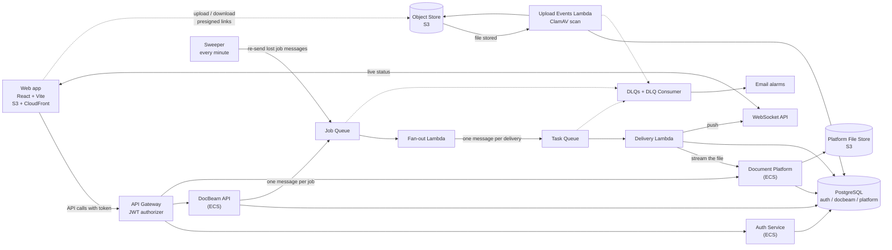

# DocBeam

**Send up to 100 files to up to 20 team folders in one action, watch every delivery as it happens, and download what arrived.**

DocBeam is a batch document distribution app for clinical trial teams. It is a portfolio project: designed first (`docs/design/`), then built in six milestones, and shown running on AWS (Sydney) from Terraform. Prod is written but never deployed.

> **Demo video:** _link to be added after the recording_ (the script is [docs/DEMO-SCRIPT.md](docs/DEMO-SCRIPT.md)).

## The problem

Research teams keep trial documents in a fixed hierarchy: Team, Binder, Folder, Document. A coordinator often has to put the same ten regulatory documents into fifteen binders at five hospitals. Today that is 150 separate uploads, nobody can see which ones failed halfway, and in a clinical trial a document that did not arrive is a compliance risk.

DocBeam turns it into one action:

1. Pick the files once. They are checked and scanned for malware in the background.
2. Tick the destination folders (only the teams you belong to are shown).
3. Send. The server confirms the job at once and delivers every file-to-folder pair on its own, in the background.
4. Watch the counts and rows change live. A failure shows its reason. The sender can retry or cancel.
5. Anyone in a destination team can preview or download what was delivered. Nobody else can tell the file exists.

## Architecture



The longer diagrams are in [docs/design/diagrams/](docs/design/diagrams/) (Eraser code).

## Key decisions

The full set is in [docs/design/04-adrs.md](docs/design/04-adrs.md) (16 decisions) and the build-time changes are in [docs/DECISIONS.md](docs/DECISIONS.md).

| Decision | Why | Where |
|---|---|---|
| Files go browser to S3 and S3 to the browser on short presigned links; the API never carries file bytes | The API does not scale with bandwidth; a link covers one object for 15 minutes (upload) or 2 minutes (download) | ADR-002, ADR-004 |
| The server checks the SHA-256 of every file twice more: S3 on write, the platform on ingest | An end-to-end integrity chain, so a corrupted file is a visible failure | ADR-002, ADR-013, M5 check 5.6 |
| Every upload is scanned with ClamAV inside a Lambda, and nothing unscanned can be sent or read | The Free plan has no GuardDuty; the bucket policy denies reads without the clean tag | ADR-016 |
| A job becomes one message; fan-out turns it into one message per delivery; each delivery succeeds or fails alone | One failed delivery never blocks the others; a message can arrive twice and the result is the same | ADR-005, ADR-008, ADR-013 |
| A lost job message is re-sent by a sweeper within about 3 minutes | The job row is saved before the message is sent | ADR-014 |
| Live status over a WebSocket, with a fetch on every reconnect | The page is never wrong for long, even if a push is dropped | ADR-007 |
| An append-only audit trail enforced by database grants | No code path can edit or delete history | ADR-009, D-G8 |
| "Not allowed" and "does not exist" look the same (404) | A stranger learns nothing about a file | flow 4, D-M4-3 |
| Terraform for everything; the console is read only | The environment can be rebuilt from nothing, and was (M5) | ADR-012, [the runbook](docs/RUNBOOK-first-bring-up.md) |
| Database TLS checks the certificate chain (RDS bundle in every image) | No silent downgrade to an unchecked connection | D-M5-4 |

Found while proving it on AWS in M5 (each is a decision record with the evidence): a 10,000-parameter insert that made big submissions slow (D-M5-10), a missing `s3:ListBucket` that turned a removed file into a retry loop (D-M5-8), a Lambda too small for a 1 GiB delivery (D-M5-12), and database pools that did not recover after a failover (D-M5-13).

## Run it locally

You need Node 22, npm and Docker (Compose v2). Nothing else.

```bash
scripts/local-env.sh                   # creates .env: safe defaults, plus a local signing key and secrets
npm install
docker compose up -d --build --wait   # every container reports healthy
docker compose run --rm seed           # demo teams, binders, folders and users; safe to repeat
npm run dev -w @docbeam/web            # http://localhost:5173
```

Sign in as `priya.shah@example.com` (Cardio and Oncology), `raj.mehta@example.com` (Cardio) or `sam.ito@example.com` (Neuro). The password is `SEED_USER_PASSWORD` in your `.env`.

| What | Address |
|---|---|
| Auth Service, Document Platform, DocBeam API | http://localhost:3001, :3002, :3003 (`/health`) |
| Web app (dev server) | http://localhost:5173 |
| ws-local (stand-in for the WebSocket API) | ws://localhost:3004 |
| PostgreSQL, LocalStack (S3 and SQS), ClamAV | localhost:5432, :4566, :3310 |

Locally the `workers` container polls the LocalStack queues and runs the same handler code that runs in Lambda.

## Tests

| Layer | Command | Result at the end of M5 |
|---|---|---|
| Unit and web (vitest) | `npm test` | 76 files, 577 tests |
| Integration (Compose + LocalStack, real ClamAV) | `npm run test:integration` | 18 files, 169 tests |
| Browser (Playwright, local) | `npm run test:e2e` | 49 tests |
| Browser on dev (Playwright) | `npm run test:e2e:dev` | see M5 below |
| Checks on deployed dev | `scripts/m5-all.sh` | see M5 below |
| Repository safe to publish | `scripts/check-public.sh` | gitleaks clean over every commit |

Also: `npm run lint`, `npm run typecheck`, `terraform fmt -check -recursive infra`, `terraform validate` for dev and prod.

## M5: proved on deployed dev

M5 runs the success metrics of the [blueprint](docs/design/02-blueprint.md) against a dev built from nothing with the [runbook](docs/RUNBOOK-first-bring-up.md). Each check is a re-runnable script (`scripts/m5-*.sh`); the evidence is in [docs/testing/m5-evidence/](docs/testing/m5-evidence/) and the table with every number is [docs/testing/M5-RESULTS.md](docs/testing/M5-RESULTS.md).

| Check | Result |
|---|---|
| 100 x 20 job accepted in under 500 ms at p99 | **No.** p99 749 to 992 ms over four runs; median 32 ms; the 100 x 20 jobs take 0.35 to 1.6 s (D-M5-10, D-M5-11) |
| Member removed from one of 20 teams: that team's 100 deliveries refused, 1,900 delivered | Yes |
| Platform stopped for 5 minutes mid-run: backlog drains, DLQ empty | Yes: 3,522 retries, 2,000 of 2,000 delivered once, DLQs 0 |
| File never uploaded refused; file removed after submit fails only its tasks | Yes (after D-M5-8) |
| Browse under 1 s for a user in 50 teams | Yes: p99 784 ms from a laptop over the internet, 44 ms at the gateway |
| 1 GiB multipart upload, delivered with a matching SHA-256 | Yes: delivered in 37 s (after D-M5-12) |
| Team viewer sees only their team; 404 for another team's file | Yes |
| Database failover during a run | Yes: failover 20 s, 2,000 of 2,000 delivered once (after D-M5-13) |
| EICAR refused, never downloadable | Yes |
| Cancel mid-run | Yes: 280 finished, 1,720 cancelled, job reads cancelled |
| Refresh token reuse ends the sign-in; 5 wrong passwords pause for 15 minutes | Yes |
| Security: 401 at the gateway, cross-team 404, expired link 403, gitleaks clean | Yes |
| Dropped job message: sweeper starts fan-out within 3 minutes | 179 s on the first run, which was too close; the sweeper now re-sends after 1 minute instead of 2 (D-M5-15, worst case about 2 minutes 10 seconds); to be re-run on dev |
| Browser: slow connection, multipart resume, WebSocket reconnect, PNG and JPG preview | see M5-RESULTS |
| Delivery failure rate (system failures over all tasks) | 0 of 12,872 after the fixes; 853 of 24,398 (3.5%) in the one run before the pool fix |

## Deploy to AWS

Everything runs in one account, region `ap-southeast-2` (Sydney), on the Free plan. Every resource is created by Terraform; the console is for reading only.

- **First bring-up of an environment, in the one order that works:** [docs/RUNBOOK-first-bring-up.md](docs/RUNBOOK-first-bring-up.md).
- **Tear down** (empties the two data buckets first, because `destroy` cannot): the runbook, section 8.
- **Dev costs about 4.5 USD a day while it is up.** Tear it down when you are not using it.
- **Prod** is defined in `infra/envs/prod` and deployed only by a manual workflow run from `main` with the typed input `deploy-prod` (D-G3). It is **not deployed in this project**. What it would need is in the runbook, section 9, and in [docs/STATUS.md](docs/STATUS.md).

### One-time setup (by hand)

1. **Deploy user (D-G1).** The IAM user `docbeam-github-deploy`, one access key, stored as the GitHub repository secrets `AWS_ACCESS_KEY_ID` and `AWS_SECRET_ACCESS_KEY`. Never put the key in a file or a commit.
2. **GitHub.** Repository variables `AWS_REGION` and `TF_STATE_BUCKET`; environments `dev` and `prod` (prod: `main` only).
3. **State bucket.** `bootstrap/create-state-backend.sh` creates `docbeam-tfstate-<account id>`; it does nothing if the bucket exists.

### Switches (repository variables)

| Variable | Turns on | When |
|---|---|---|
| `INFRA_APPLY_ENABLED` | `terraform apply` for dev on merge to `main` | `false` while dev is down |
| `ECS_DEPLOY_ENABLED` | service and web deploy jobs | from M1 |
| `LAMBDA_DEPLOY_ENABLED` | worker and Upload Events deploy jobs | from M2 |
| `ALARM_EMAIL` | the address that gets alarm emails | before M2 |

Deploy jobs skip, with a notice, when their switch is not `true`, when the environment does not exist, or when it already runs that version.

### Roll back

- **A service (ECS):** `scripts/deploy-service.sh <env> <service> <previous image uri>` (registers the older image, runs the forward-only migrations, waits for the service).
- **A worker (Lambda):** re-run the `workers` workflow on the previous commit with `force`, or `scripts/deploy-lambda.sh <env> <function> <bundle-dir | image-uri> --force`.
- **The web app:** check out the previous commit and run `scripts/deploy-web.sh <env>`.
- **Infrastructure:** revert the commit and let the `infra` workflow plan and apply, or apply from the previous commit. Read the plan first.

## Documents

| Read | For |
|---|---|
| [docs/design/02-blueprint.md](docs/design/02-blueprint.md) | scope, requirements, success metrics |
| [docs/design/03-user-flows.md](docs/design/03-user-flows.md) | the four user flows |
| [docs/design/04-adrs.md](docs/design/04-adrs.md) | every architecture decision and why |
| [docs/design/05-technical-design.md](docs/design/05-technical-design.md) | schemas, API contracts, milestones, failure handling |
| [docs/DECISIONS.md](docs/DECISIONS.md) | changes agreed during the build (wins over the design) |
| [docs/STATUS.md](docs/STATUS.md), [docs/PLAN.md](docs/PLAN.md) | where the build is, the task lists |
| [docs/testing/](docs/testing/) | per milestone: how it was tested and the evidence |
| [docs/walkthrough/](docs/walkthrough/) | plain-English tours of what each milestone built |

## Folder map

```
services/
  auth/              Auth Service (ECS). Owns auth_db and its migrations/
  platform/          Document Platform (ECS). Owns platform_db, migrations/ and seed/
  docbeam-api/       DocBeam API (ECS). Owns docbeam_db and its migrations/
workers/
  fanout/ delivery/ dlq/ ws/ sweeper/   Lambda handlers, bundled with esbuild
  upload-events/     Lambda container image with ClamAV (ADR-016)
web/                 React and Vite app, served by S3 and CloudFront
packages/
  shared/            Limits, error shape, JWT checks, database pools, the RDS certificate bundle
  worker-runtime/    Runs the Lambda handlers against LocalStack queues; ws-local
infra/
  modules/           network, rds, ecr, s3, cloudfront, api-gateway, alb, ecs-cluster, ecs-service,
                     secrets, sqs, lambda, scheduler, alarms, websocket-api
  envs/dev, envs/prod  Call the modules with dev or prod values (prod: defined, not deployed)
bootstrap/           One-time state bucket script
docker/              Service and worker Dockerfiles, Postgres and LocalStack init, DB bootstrap
scripts/             push-image, deploy-service, deploy-lambda, deploy-web, run-task, empty-dev-buckets,
                     m5-*.sh (the M5 checks), check-public.sh, demo-*.sh
tests/               integration/ (Compose), e2e/ (Playwright), scripts/ (deploy scripts)
.github/workflows/   One workflow per service, workers, Upload Events image, infra, CI
docs/                Design, plan, status, decisions, testing records, walkthroughs, runbook
```

Two rules: `infra/envs/*` never holds resources of its own, and each service keeps its migrations in its own folder (ADR-009). Rules for coding agents are in `AGENTS.md`.
