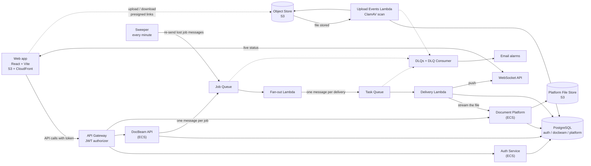
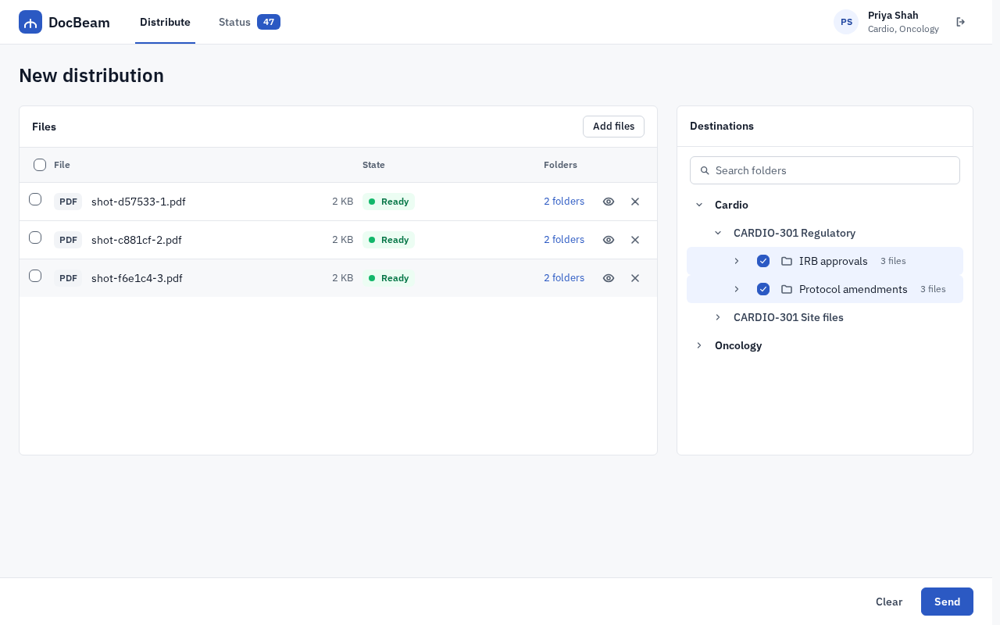
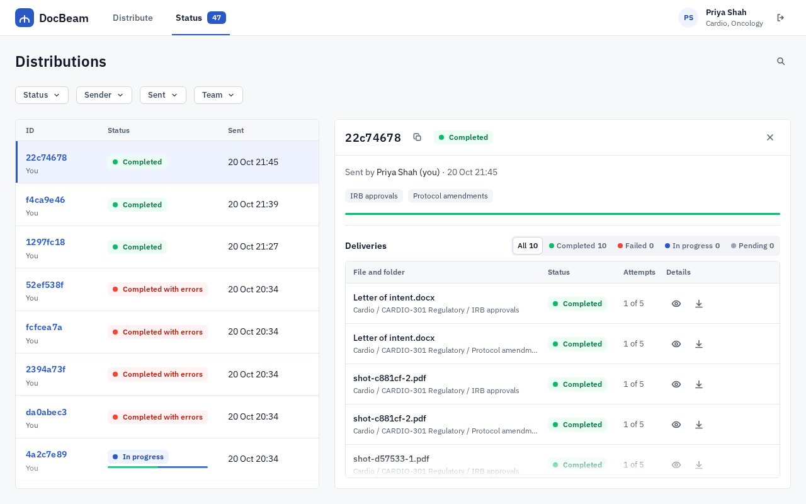

# DocBeam

**Send up to 100 files to up to 20 team folders in one action, watch every delivery as it happens, and download what arrived.**

DocBeam is a batch document distribution app for clinical trial teams. It is a portfolio project: designed first (`docs/design/`), then built in six milestones, and shown running on AWS (Sydney) from Terraform. Prod is written but never deployed.

> **Demo video:** [docs/demo/docbeam-demo.mp4](docs/demo/docbeam-demo.mp4) (also as [webm](docs/demo/docbeam-demo.webm); 4 minutes 55 seconds; recorded by a script, `scripts/demo/record.ts`, **locally** (docker compose, seeded) on the final code (D-F1-81) on 2026-10-22: 1280x720, a visible cursor and a caption for each step; the plan is [docs/DEMO-SCRIPT.md](docs/DEMO-SCRIPT.md)). Dev is torn down after each round of work, so the site it shows is not up.

## At a glance

Measured on the deployed dev site (AWS Sydney). The latest run leads; older runs are listed as history in the sections below. Largest job: 100 files to 20 teams, which is **2,000 deliveries**.

| Measure | Latest result | Date | Evidence |
|---|---|---|---|
| Accepting the largest job (`POST /jobs`, server side), normal operation | p99 175 ms (p50 35 ms) over 100 jobs | 2026-10-20 | [submit-load-quiet.txt](docs/testing/f1-evidence/dev/submit-load-quiet.txt) |
| The same under peak delivery load | p99 452 ms | 2026-10-20 | [submit-load-loaded.txt](docs/testing/f1-evidence/dev/submit-load-loaded.txt) |
| One largest job, accepted to first delivery | 4.6 s | 2026-10-21 | [delivery-timing.txt](docs/testing/f1-evidence/dev/delivery-timing.txt) |
| One largest job, accepted to half delivered (1,000) | 16.8 s | 2026-10-21 | same |
| One largest job, accepted to all 2,000 delivered | 26.2 s (about 92 deliveries a second); 0 failed | 2026-10-21 | same, and [server side](docs/testing/f1-evidence/dev/delivery-timing-server.txt) (that request took 763 ms at the gateway; 2.4 s seen from the laptop) |
| Delivery failure rate (system failures over all deliveries) | 0 of 12,872 after the fixes | 2026-10-17 | [failure-rate.txt](docs/testing/m5-evidence/failure-rate.txt) (history: 853 of 24,398, 3.5%, in the one run before the pool fix) |
| Platform stopped for 5 minutes, then database failover (about 20 s) during a run | 2,000 of 2,000 delivered once each, DLQs empty | 2026-10-17 | [platform-outage.txt](docs/testing/m5-evidence/platform-outage.txt), [failover.txt](docs/testing/m5-evidence/failover.txt) |
| Browsing the first level of the tree for a user in 50 teams (one call) | p99 832 ms from a laptop over the internet, 49 ms at the gateway | 2026-10-20 | [browse-timing.txt](docs/testing/f1-evidence/dev/browse-timing.txt) |
| A 1 GiB file, uploaded in 64 parts, scanned and delivered | 54 s to upload, 95 s to scan, 36.9 s to deliver; same SHA-256 | 2026-10-18 | [multipart-1gb.txt](docs/testing/m5-evidence/multipart-1gb.txt) |
| Virus scan (ClamAV) | about 15 s a file, 10 files at a time (100 files take about 2.5 minutes) | 2026-10-18 | [M5-RESULTS.md](docs/testing/M5-RESULTS.md) |
| Cost of dev while it is up | about 3 to 5 USD a day, torn down when not in use | 2026-10 | [AGENTS.md](AGENTS.md), [STATUS.md](docs/STATUS.md) |
| Tests | 959 unit (102 files), 218 integration (18 files, real ClamAV), 142 browser (17 more are skipped: the dev-only and screenshot specs); lint and typecheck clean | 2026-10-22 | [F1-RESULTS.md](docs/testing/F1-RESULTS.md) section 8.10 |

## The problem

Research teams keep trial documents in a fixed hierarchy: Team, Binder, Folder, Document. A coordinator often has to put the same ten regulatory documents into fifteen binders at five hospitals. Today that is 150 separate uploads, nobody can see which ones failed halfway, and in a clinical trial a document that did not arrive is a compliance risk.

DocBeam turns it into one action:

1. Add the files once. The page reads each file's first bytes (and a DOCX's or XLSX's ZIP file list) and adds only a real PDF, DOCX, XLSX, PNG or JPG whose contents are the type its name says; any other file is listed in a "not added" box with the reason, and the grey type tag always shows what the contents are. The files are scanned for malware in the background; each shows Uploading, Scanning, Ready, Failed (it can be tried again) or Refused (malware was found: final).
2. Tick the destination folders (only the teams you belong to are shown; only folders can be ticked, binders are headings). A tick goes to the selected files, or to all files, including files added later while it stays ticked.
3. Send. One line says what goes where ("3 files to 5 folders: 15 deliveries"), a question asks once, and the server confirms the distribution at once and delivers every file-to-folder pair on its own, in the background.
4. Watch the distribution in a side panel: the numbers and rows change live, a failure shows its reason, and the sender can retry the failed ones or cancel. The page shows job history only; the audit records are kept by the backend.
5. Anyone in a destination team can preview or download what was delivered. Nobody else can tell the file exists.

## Architecture



The longer diagrams are in [docs/design/diagrams/](docs/design/diagrams/) (Eraser code).

## Key decisions

The full set is in [docs/design/04-adrs.md](docs/design/04-adrs.md) (16 decisions) and the build-time changes are in [docs/DECISIONS.md](docs/DECISIONS.md).

| Decision | Why | Where |
|---|---|---|
| Files go browser to S3 and S3 to the browser on short presigned links; the API never carries file bytes | The API does not scale with bandwidth; a link covers one object for 15 minutes (upload) or 2 minutes (download) | ADR-002, ADR-004 |
| The server checks the SHA-256 of every file twice more: S3 on write, the platform on ingest | An end-to-end integrity chain, so a corrupted file is a visible failure | ADR-002, ADR-013, M5 check 5.6 |
| Every upload is scanned with ClamAV inside a Lambda, and nothing unscanned can be sent or read | The Free plan has no GuardDuty; the bucket policy denies reads without the clean tag | ADR-016 |
| A job becomes one message; fan-out turns it into one message per delivery; each delivery succeeds or fails alone | One failed delivery never blocks the others; a message can arrive twice and the result is the same | ADR-005, ADR-008, ADR-013 |
| A lost job message is re-sent by a sweeper within about 3 minutes | The job row is saved before the message is sent | ADR-014 |
| Live status over a WebSocket, with a fetch on every reconnect | The page is never wrong for long, even if a push is dropped | ADR-007 |
| An append-only audit trail enforced by database grants | No code path can edit or delete history | ADR-009, D-G8 |
| "Not allowed" and "does not exist" look the same (404) | A stranger learns nothing about a file | flow 4, D-M4-3 |
| Terraform for everything; the console is read only | The environment can be rebuilt from nothing, and was (M5) | ADR-012, [the runbook](docs/RUNBOOK-first-bring-up.md) |
| Database TLS checks the certificate chain (RDS bundle in every image) | No silent downgrade to an unchecked connection | D-M5-4 |

Found while proving it on AWS in M5 (each is a decision record with the evidence): a 10,000-parameter insert that made big submissions slow (D-M5-10), a missing `s3:ListBucket` that turned a removed file into a retry loop (D-M5-8), a Lambda too small for a 1 GiB delivery (D-M5-12), and database pools that did not recover after a failover (D-M5-13).

## Run it locally

You need Node 22, npm and Docker (Compose v2). Nothing else.

```bash
scripts/local-env.sh                   # creates .env: safe defaults, plus a local signing key and secrets
npm install
docker compose up -d --build --wait   # every container reports healthy
docker compose run --rm seed           # demo teams, binders, folders and users; safe to repeat
npm run dev -w @docbeam/web            # http://localhost:5173
```

Sign in as `priya.shah@example.com` (Cardio and Oncology), `raj.mehta@example.com` (Cardio), `sam.ito@example.com` (Neuro) or `paging.user@example.com` (one folder with 60 subfolders, to see paging). The password is `SEED_USER_PASSWORD` in your `.env`.

| What | Address |
|---|---|
| Auth Service, Document Platform, DocBeam API | http://localhost:3001, :3002, :3003 (`/health`) |
| Web app (dev server) | http://localhost:5173 |
| ws-local (stand-in for the WebSocket API) | ws://localhost:3004 |
| PostgreSQL, LocalStack (S3 and SQS), ClamAV | localhost:5432, :4566, :3310 |

Locally the `workers` container polls the LocalStack queues and runs the same handler code that runs in Lambda.

## Tests

| Layer | Command | Latest result (2026-10-21) |
|---|---|---|
| Unit and web (vitest) | `npm test` | 102 files, 959 tests |
| Integration (Compose + LocalStack, real ClamAV) | `npm run test:integration` | 18 files, 218 tests |
| Browser (Playwright, local) | `npm run test:e2e` | 142 passed, 17 skipped (the dev-only and screenshot specs); includes the four width projects (375, 768, 1024, 1440 px) |
| Browser on dev (Playwright) | `npm run test:e2e:dev` | `download-dev` 5, `m5-browser-dev` 4 and `status-dev` 1 passed on 2026-10-22; `open-timing-dev` prints how long a distribution takes to open (D-F1-81) |
| Checks on deployed dev | `scripts/m5-all.sh` | see M5 below |
| Repository safe to publish | `scripts/check-public.sh` | gitleaks clean over every commit |

Also: `npm run lint`, `npm run typecheck`, `terraform fmt -check -recursive infra`, `terraform validate` for dev and prod.

## M5: proved on deployed dev

The numbers in this section are the M5 runs of 2026-10-17 and 2026-10-18: history. The latest numbers are in "At a glance" above. M5 runs the success metrics of the [blueprint](docs/design/02-blueprint.md) against a dev built from nothing with the [runbook](docs/RUNBOOK-first-bring-up.md). Each check is a re-runnable script (`scripts/m5-*.sh`); the evidence is in [docs/testing/m5-evidence/](docs/testing/m5-evidence/) and the table with every number is [docs/testing/M5-RESULTS.md](docs/testing/M5-RESULTS.md).

| Check | Result |
|---|---|
| A 100 x 20 job (2,000 deliveries) accepted in under 500 ms at p99 in normal operation, and under 1 s at p99 under peak delivery load (the requirement was changed from a single 500 ms target after measuring, D-M5-17) | **Yes, with a thin margin.** Normal operation: 225 ms (one run). Peak delivery load: seven runs, p99 330 to 992 ms, worst 992 ms against the 1,000 ms limit; against the old 500 ms target five of the seven fail. Single requests reached 1.6 s. Known limit: under peak load the time is lost in the database (a small `db.t4g.micro`, up to 49 Delivery copies queuing on one job's row lock); a larger database and a shorter lock are planned, not done |
| Member removed from one of 20 teams: that team's 100 deliveries refused, 1,900 delivered | Yes |
| Platform stopped for 5 minutes mid-run: backlog drains, DLQ empty | Yes: 3,522 retries, 2,000 of 2,000 delivered once, DLQs 0 |
| File never uploaded refused; file removed after submit fails only its tasks | Yes (after D-M5-8) |
| Browse under 1 s for a user in 50 teams | Yes: p99 784 ms from a laptop over the internet, 44 ms at the gateway |
| 1 GiB multipart upload, delivered with a matching SHA-256 | Yes: delivered in 37 s (after D-M5-12) |
| Team viewer sees only their team; 404 for another team's file | Yes |
| Database failover during a run | Yes: failover 20 s, 2,000 of 2,000 delivered once (after D-M5-13) |
| EICAR refused, never downloadable | Yes |
| Cancel mid-run | Yes: 280 finished, 1,720 cancelled, job reads cancelled |
| Refresh token reuse ends the sign-in; 5 wrong passwords pause for 15 minutes | Yes |
| Security: 401 at the gateway, cross-team 404, expired link 403, gitleaks clean | Yes |
| Dropped job message: sweeper starts fan-out within 3 minutes | Yes: 113 s after the sweeper was changed to re-send after 1 minute instead of 2 (D-M5-15, worst case about 2 minutes 10 seconds); the first run was 179 s, too close |
| Browser: slow connection, multipart resume, WebSocket reconnect, PNG and JPG preview | see M5-RESULTS |
| Delivery failure rate (system failures over all tasks) | 0 of 12,872 after the fixes; 853 of 24,398 (3.5%) in the one run before the pool fix |

## F1: the reviewer's feedback round

After M5 a reviewer asked for a calmer, clearer tool. What changed (details: [docs/testing/F1-RESULTS.md](docs/testing/F1-RESULTS.md), decisions D-F1-1 to D-F1-12 in [docs/DECISIONS.md](docs/DECISIONS.md), a plain-English tour in [docs/walkthrough/F1.md](docs/walkthrough/F1.md)):

- **A design system.** The stylesheet starts with tokens (a neutral palette, one accent, status colours for status only, five text sizes, a 4 px scale, one radius, one shadow); one status chip; one icon style; one font. Screens work from 1024 px up.
- **Distribute is two cards that fill the window (D-F1-39).** From 1024 px up the page does not scroll: Files on the left and Destinations on the right are as tall as the window leaves room for, and the file list and the folder tree scroll inside their cards. Clear and Send sit in a bar at the bottom; one question asks before it goes ("Send 3 files to 5 folders?" with the full summary). A click on a file row ticks or unticks it (no Ctrl needed; Shift extends); the Destinations title carries no "for N selected files" label and the bar carries no summary line, only the reason Send is off, as small text. **Only folders are destinations; binders are headings.** A folder ticked for all files stays ticked for files added later. A file is added only if its contents are the type its name says (first bytes, and a DOCX's or XLSX's ZIP file list); the type tag on a row comes from the contents too, and the same check runs again on the server (D-F1-44).
- **Status shows job history only (D-F1-13).** One list of everything you can see, newest first: ID (with the sender below it), Status, Sent, Files (the first file name and "+N") and Destinations (the first two folders and "+N"), filling the window; the list scrolls inside its own area and loads the next page as you reach the end ("Loading more…", "That's everything"; no "Show more", D-F1-49). One row of filters sits above it (Status, Sender, Sent, and Team when you are in more than one; they live in the address, D-F1-21). Open a distribution and the list narrows beside a **split view** panel: a dense header (ID, copy icon, status, close; "Sent by" and the time; for a team member a one-line note of whose deliveries these are, with the teams that do not fit as "+N"), a thin progress bar, status tabs and the deliveries table (the file type, the folder, the status and, for a delivery on its second try or failed, a small attempt note). Past 15 deliveries a "Filter…" box appears. Both tables use one 52 px row height (D-F1-56). Every time is written one way ("Today, 04:34", "Yesterday, 18:10", "21 Oct, 04:34", "3 Mar 2025, 14:02", 24-hour, your time zone); hover or focus shows the full time with seconds and the zone (D-F1-59). Reasons are in tooltips, not under the chips: on a failed delivery or file, hover, focus or click the chip (or the info icon) for one plain sentence from one reason map, with the attempts where they apply (D-F1-60). The Details column is icons only. Password fields have an eye button to show the password (D-F1-61). A delivery that is still being checked shows **Scanning**, a failed one a **Retry** and a file the scan refused **Refused**. There is no audit view in the page; `GET /audit` stays in the API.
- **One look for filters, counts and tips (D-F1-41, D-F1-42, D-F1-47).** Every long list has the same "Filter…" box once it holds more than about 15 rows. A "+N" or "N folders" count opens one popover (on hover after 300 ms, on focus or on a click) with the full list. Hover hints are one tooltip component. Panels, dialogs and the tree move a little when they open and close, all of it switched off for people who ask for reduced motion (`prefers-reduced-motion`). Popovers and the page layout work from 1440 down to 1024 px.
- **No sign-up in the web app (D-F1-17).** The study administrator sets accounts up (the seed script). `POST /auth/register` stays in the Auth Service and is switched off at the gateway by `public_registration_enabled`.
- **Browsing is paged.** The four platform browse routes take `limit` and an opaque `cursor`; the tree loads 20 rows and more on scroll; the list of distributions loads 20 at a time as you scroll (the next page is asked for when its scroll area comes within about five rows of the end, with "Loading more…" while it comes and "That's everything" at the end; no page numbers and no "Show more", D-F1-49). The copy icon after a distribution ID copies its link.
- **Measured on dev:** see "At a glance" at the top for the latest numbers. Ticking one of 40 folders draws one row (was 40).
- **Demo video:** [docs/demo/docbeam-demo.mp4](docs/demo/docbeam-demo.mp4) and [webm](docs/demo/docbeam-demo.webm), 4 minutes 55 seconds, recorded locally on the final code (D-F1-81) on 2026-10-22 (the infected file leaves the list with a note, the one Notice style, D-F1-78) (the mp4 is made from the webm with ffmpeg) by `scripts/demo/record.ts`; the recorder can also record dev. Screenshots of every screen at 1440, 1280 and 1024 px: [docs/testing/f1-evidence/after/](docs/testing/f1-evidence/after/).





## Deploy to AWS

Everything runs in one account, region `ap-southeast-2` (Sydney), on the Free plan. Every resource is created by Terraform; the console is for reading only.

- **First bring-up of an environment, in the one order that works:** [docs/RUNBOOK-first-bring-up.md](docs/RUNBOOK-first-bring-up.md).
- **Tear down** (empties the two data buckets first, because `destroy` cannot): the runbook, section 8.
- **Dev costs about 4.5 USD a day while it is up.** Tear it down when you are not using it.
- **Prod** is defined in `infra/envs/prod` and deployed only by a manual workflow run from `main` with the typed input `deploy-prod` (D-G3). It is **not deployed in this project**. What it would need is in the runbook, section 9, and in [docs/STATUS.md](docs/STATUS.md).

### One-time setup (by hand)

1. **Deploy user (D-G1).** The IAM user `docbeam-github-deploy`, one access key, stored as the GitHub repository secrets `AWS_ACCESS_KEY_ID` and `AWS_SECRET_ACCESS_KEY`. Never put the key in a file or a commit.
2. **GitHub.** Repository variables `AWS_REGION` and `TF_STATE_BUCKET`; environments `dev` and `prod` (prod: `main` only).
3. **State bucket.** `bootstrap/create-state-backend.sh` creates `docbeam-tfstate-<account id>`; it does nothing if the bucket exists.

### Switches (repository variables)

| Variable | Turns on | When |
|---|---|---|
| `INFRA_APPLY_ENABLED` | `terraform apply` for dev on merge to `main` | `false` while dev is down |
| `ECS_DEPLOY_ENABLED` | service and web deploy jobs | from M1 |
| `LAMBDA_DEPLOY_ENABLED` | worker and Upload Events deploy jobs | from M2 |
| `ALARM_EMAIL` | the address that gets alarm emails | before M2 |

Deploy jobs skip, with a notice, when their switch is not `true`, when the environment does not exist, or when it already runs that version.

### Roll back

- **A service (ECS):** `scripts/deploy-service.sh <env> <service> <previous image uri>` (registers the older image, runs the forward-only migrations, waits for the service).
- **A worker (Lambda):** re-run the `workers` workflow on the previous commit with `force`, or `scripts/deploy-lambda.sh <env> <function> <bundle-dir | image-uri> --force`.
- **The web app:** check out the previous commit and run `scripts/deploy-web.sh <env>`.
- **Infrastructure:** revert the commit and let the `infra` workflow plan and apply, or apply from the previous commit. Read the plan first.

## Documents

| Read | For |
|---|---|
| [docs/design/02-blueprint.md](docs/design/02-blueprint.md) | scope, requirements, success metrics |
| [docs/design/03-user-flows.md](docs/design/03-user-flows.md) | the four user flows |
| [docs/design/04-adrs.md](docs/design/04-adrs.md) | every architecture decision and why |
| [docs/design/05-technical-design.md](docs/design/05-technical-design.md) | schemas, API contracts, milestones, failure handling |
| [docs/USER-FLOW-AND-APIS.md](docs/USER-FLOW-AND-APIS.md) | the whole user flow, screen by screen, with every call and answer behind it, presigned links explained, with recorded traffic and annotated screenshots |
| [docs/DECISIONS.md](docs/DECISIONS.md) | changes agreed during the build (wins over the design) |
| [docs/STATUS.md](docs/STATUS.md), [docs/PLAN.md](docs/PLAN.md) | where the build is, the task lists |
| [docs/testing/](docs/testing/) | per milestone: how it was tested and the evidence |
| [docs/walkthrough/](docs/walkthrough/) | plain-English tours of what each milestone built |
| [docs/CODE-WALKTHROUGH.md](docs/CODE-WALKTHROUGH.md) | every file in the repository and why it exists, in reading order |

## Folder map

```
services/
  auth/              Auth Service (ECS). Owns auth_db and its migrations/
  platform/          Document Platform (ECS). Owns platform_db, migrations/ and seed/
  docbeam-api/       DocBeam API (ECS). Owns docbeam_db and its migrations/
workers/
  fanout/ delivery/ dlq/ ws/ sweeper/   Lambda handlers, bundled with esbuild
  upload-events/     Lambda container image with ClamAV (ADR-016)
web/                 React and Vite app, served by S3 and CloudFront
packages/
  shared/            Limits, error shape, JWT checks, database pools, the RDS certificate bundle
  worker-runtime/    Runs the Lambda handlers against LocalStack queues; ws-local
infra/
  modules/           network, rds, ecr, s3, cloudfront, api-gateway, alb, ecs-cluster, ecs-service,
                     secrets, sqs, lambda, scheduler, alarms, websocket-api
  envs/dev, envs/prod  Call the modules with dev or prod values (prod: defined, not deployed)
bootstrap/           One-time state bucket script
docker/              Service and worker Dockerfiles, Postgres and LocalStack init, DB bootstrap
scripts/             push-image, deploy-service, deploy-lambda, deploy-web, run-task, empty-dev-buckets,
                     m5-*.sh (the M5 checks), check-public.sh, demo-*.sh
tests/               integration/ (Compose), e2e/ (Playwright), scripts/ (deploy scripts)
.github/workflows/   One workflow per service, workers, Upload Events image, infra, CI
docs/                Design, plan, status, decisions, testing records, walkthroughs, runbook
```

Two rules: `infra/envs/*` never holds resources of its own, and each service keeps its migrations in its own folder (ADR-009). Rules for coding agents are in `AGENTS.md`.
