# From a click to a delivery: the user flow and the APIs behind it

This guide follows one person through DocBeam, screen by screen, and shows the data and the calls behind every screen. It is written so that you can explain the whole product to someone who has never met a presigned link. Plain English comes first in every chapter; the exact requests and answers come second.

**How to read it.** There is one chapter for each step of the journey: sign in, add files, choose folders, send, watch it, a team member's view, preview and download. A short chapter on presigned links comes before the one on files, because they are the idea most people are new to.

**Where the pictures and numbers come from.** Everything here was recorded by `scripts/user-flow/capture.ts` on the local stack (Docker Compose, with LocalStack standing in for S3), as Priya, Raj and Sam, the seeded demo people. Each request the page made was recorded with its method, path, status, time and size. Tokens, signatures, cookies and passwords are masked (`<masked>`); nothing secret is in this repository. The times are local (a few milliseconds to a few hundred), not AWS times. Where an answer could not be provoked by clicking (a mocked 401, a request the capture sent itself) the guide says so.

**Two things to know about the request tables.** (1) They list HTTP requests only; the WebSocket frames are described in the text and are in `docs/user-flow/capture/traffic.json`. (2) The page was served by the Vite development server, where React runs each effect twice on purpose, so some requests appear twice in a row (for example `GET /jobs/{jobId}` when a distribution is opened). On the built site each fires once.

**Reading a picture.** Each screenshot has numbered markers. A purple outline marks the thing on the screen, and the label in the right-hand margin says where it comes from: `GET /jobs → status` means "the field `status` of the answer to `GET /jobs`"; `computed in the browser` means the page works it out itself; `typed by you` means it is your input. The figures with a table of requests are drawn from the recorded requests; they are not DevTools screenshots.

**The words you need.**

| Word | Meaning here |
|---|---|
| Access token | A short-lived signed pass (a JWT, 15 minutes) the page sends with every call, in the `Authorization` header. It says who you are. |
| Refresh cookie | A long-lived cookie the page cannot read (HttpOnly). It only buys a new access token, from `POST /auth/refresh`. |
| Presigned link | A web address that carries its own permission: signed by the server, good for one object and a few minutes. Chapter "Presigned links". |
| SHA-256 | A fingerprint of a file's bytes. If one byte changes, the fingerprint changes. |
| Multipart upload | A big file sent in pieces ("parts"), each with its own link. |
| Queue (SQS) | A line of small messages. One side puts a message in; another side takes it out and does the work. |
| Lambda | A small program that AWS runs when a message arrives. |
| WebSocket | A connection that stays open so the server can tell the page things as they happen. |
| Idempotency key | A random label sent with "create a distribution", so sending the same request twice makes one distribution. |

## The big picture

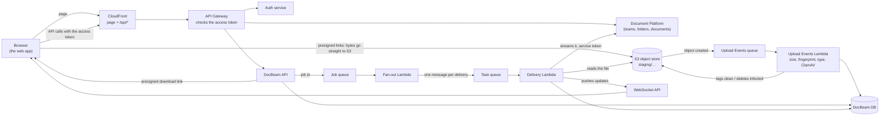

Three ideas run through the whole guide:

1. **The API never carries the bytes of a file.** It only hands out permission to move them (a presigned link) and keeps the records. Files go from the browser straight to S3, and from S3 straight to the platform.
2. **A distribution is made from files that are already safe.** Files are uploaded and scanned first; only then does "Send" create the distribution, which just points at them by id.
3. **Every screen is built from a few calls plus a little work in the browser.** The tables in each chapter say which is which.

---

## Presigned links, explained

*Read this before chapter 2 if you have not met them.*

### The permission slip

Imagine a warehouse where only staff may put boxes on the shelves. You are not staff, and the warehouse does not want you walking through the office. So the office writes you a **slip**: "The bearer may put one box on shelf 14, up to 5 kg, before 3:15 pm. Signed: the office." You walk straight to the shelf and hand the slip to the guard. The guard does not call the office. He checks the signature, the shelf, the weight and the time, and lets you in. If any of it is wrong, he refuses.

A **presigned link** is that slip. The "office" is the DocBeam API, the "warehouse" is S3, and the "signature" can only be made by someone who holds AWS's secret key, which the browser never sees. The API signs the slip after checking that you are allowed (you own the file record; or you are the sender, or in a team the file was delivered to). S3 checks the slip when you use it. The file travels from your browser to S3 without passing through the API.

### What is inside a link

Here is the answer to `POST /uploads` for one small file, exactly as recorded (the bucket is LocalStack's; the signature, credential and policy are masked):

```json
{
  "uploads": [
    {
      "fileId": "6c5d6b65-8c74-46a4-9333-e53bf63f7185",
      "post": {
        "url": "http://localhost:4566/docbeam-local-object-store",
        "fields": {
          "Content-Type": "application/pdf",
          "x-amz-checksum-sha256": "oiv8yPgMQUgme0exv+p42rx0mHWuTmeJLAMglqhPDww=",
          "bucket": "docbeam-local-object-store",
          "X-Amz-Algorithm": "AWS4-HMAC-SHA256",
          "X-Amz-Credential": "<masked>",
          "X-Amz-Date": "20261021T075305Z",
          "key": "staging/a3cf6c1d-1a43-43a2-876f-25775f45663d/6c5d6b65-8c74-46a4-9333-e53bf63f7185",
          "Policy": "<masked>",
          "X-Amz-Signature": "<masked>"
        }
      }
    }
  ]
}
```

This one is an upload slip (a **presigned POST**): a web address plus the form fields the browser must send with the file. Read it as the slip above:

| Part | What it is | In the slip analogy |
|---|---|---|
| `url`, `bucket` | Where to deliver the box: the S3 bucket | The warehouse |
| `key` | The exact object name: `staging/<your user id>/<file id>` | Shelf 14 |
| `Policy` (masked) | A signed list of rules: the key must be this one, the size at most so many bytes, the type this one, the fingerprint this one, and an **expiry time** | "up to 5 kg, before 3:15 pm" |
| `x-amz-checksum-sha256` | The file's fingerprint, declared by the browser. S3 recomputes it and refuses a different file | The box must match the description |
| `X-Amz-Credential`, `X-Amz-Algorithm`, `X-Amz-Date` | Which signing key made the signature, how, and when | The office's stamp and date |
| `X-Amz-Signature` (masked) | The signature over the policy. Anyone can read the rest; only the signer can make a valid signature | The office's signature |

A **download** slip is a **presigned GET**: one web address, with everything in the query string. This is the answer to `POST /files/{fileId}/downloads` in the recording (the object is a delivered file, the link lasts 120 seconds):

```json
{
  "url": "http://localhost:4566/docbeam-local-object-store/staging/a3cf6c1d-…/bdb42d26-974e-4a47-8d42-1cd5746d92c1?X-Amz-Algorithm=AWS4-HMAC-SHA256&X-Amz-Content-Sha256=UNSIGNED-PAYLOAD&X-Amz-Credential=<masked>&X-Amz-Date=20261021T080359Z&X-Amz-Expires=120&X-Amz-Signature=<masked>&X-Amz-SignedHeaders=host&response-content-disposition=inline&response-content-type=application%2Fpdf&x-amz-checksum-mode=ENABLED&x-id=GetObject",
  "expiresAt": "2026-10-21T08:05:59.125Z",
  "fileName": "Consent form mvhtpf5f.pdf",
  "contentType": "application/pdf",
  "sizeBytes": 403
}
```

`X-Amz-Date` plus `X-Amz-Expires=120` is the deadline. `X-Amz-SignedHeaders=host` says which parts of the request are covered by the signature. `response-content-disposition=inline` (or `attachment; filename=…` for Download) tells S3 how to label the file when it answers, so the browser shows it or saves it under its original name.

### What S3 checks, and what happens when something is wrong

On every request S3 does the same four things, without asking the DocBeam API anything: (1) it recomputes the signature from the request and its own copy of the secret key, and compares; (2) it checks that the current time is before date + expires; (3) it checks that the method and the object name are the ones that were signed; (4) for an upload, it checks the policy's conditions (size, type, fingerprint). Any failure is a `403` (or a `400` for a body that breaks a condition).

* **An expired link:** refused with `403 AccessDenied`. This was measured on AWS dev (M5, 2026-10-17, `docs/testing/m5-evidence/security.txt`): a fresh link worked (`200`), and after waiting 130 seconds the same link answered `403` with the body `<Error><Code>AccessDenied</Code><Message>…`.
* **An altered link** (one character of the signature, or another object's name): the signature no longer matches, so AWS S3 answers `403 SignatureDoesNotMatch` (AWS's documented answer; M5 did not test this separately). M5 did measure that the bucket address **without any link** is `403` on AWS dev (`the bucket without a link: 403`).
* **A link used by the wrong person:** S3 cannot tell. A link works for anyone who holds it until it expires. That is why links cover **one object**, last **minutes** (15 for uploads, 2 for downloads, ADR-004) and are made only after the DocBeam API checked who is asking.

> The local stack uses LocalStack for S3, which does not enforce expiry or signatures the way AWS does. This was tried for this guide: a download link with one character of its signature changed, and the same address with no signature at all, both answered `200` locally (only an object name that does not exist answered `404`). The refusals above (`403`) were therefore proved on AWS dev, in M5, and the recording here shows the successful paths.

### Why the API never carries the bytes

Files go up to 1 GB, 100 at a time. If they passed through the API, it would have to be sized for the bandwidth, a slow upload would hold a connection open for minutes, and every byte would travel twice (browser to API, API to S3). With presigned links the API handles a few small requests, and S3, which is built for this, handles the bytes (ADR-002). S3 can also check the size, type and fingerprint itself, which the API could only do after receiving the whole file.

### Why upload first, then create the distribution

An alternative would be to create the distribution first and give out upload links with it. DocBeam does it the other way, on purpose:

* **"Send" stays fast.** `POST /jobs` carries only ids and fingerprints. It does not wait for bytes, so it answers in tens of milliseconds even for 2,000 deliveries (ADR-002: the submit must be confirmed in under 500 ms).
* **Nothing unscanned can be sent.** A file is confirmed (size, fingerprint, type) and scanned for malware in the background right after upload (ADR-016). `POST /jobs` only accepts files that are uploaded **and** clean, and claims them in the same database transaction that creates the distribution.
* **A link is signed when the file record is created.** At that moment the API knows who owns the file. A distribution is a separate, later decision about where the files go.

### Questions a reviewer is likely to ask

1. **"Can someone who finds a link use it?"** Yes, until it expires, and only for that one object and operation. That is the trade-off of option 1 in ADR-002; short expiry (ADR-004) and the check before signing keep it small.
2. **"What stops me asking for a link to someone else's file?"** The API checks first: for an upload, you must own the file record; for a download, you must be the sender or in a team that received the file. Anyone else gets the same `404` as for a file that does not exist (chapters 6 and 7).
3. **"What if the page is slow and the link expires mid-upload?"** A transfer that started in time finishes. For a multipart upload the page asks for fresh links for the parts not yet started (`POST …/parts`), 13 minutes after the first ones.
4. **"What if the file is swapped after upload?"** The fingerprint is checked three times: by S3 at upload, by the Upload Events Lambda after the scan, and by the Delivery Lambda before it sends the file on.
5. **"Why not one long-lived link per file?"** A leaked long link would be usable for hours or days (ADR-004 option 1).
6. **"Does the browser ever see AWS credentials?"** No. It sees the signature, which proves only the one signed request. The signing key stays on the server.
7. **"What does it cost?"** One small API call per batch of links, instead of the bytes passing through a server.
8. **"What happens to a file nobody sends?"** It stays in `staging/` for 33 days, then S3 deletes it. A file refused for malware is deleted at once.

---

## 1. Sign in

### What the user does and sees

The person opens the page and sees "Sign in" with an email and a password. They type, press **Sign in**, and land on the Distribute screen with their name and teams in the corner. If they reload, they are still signed in. After a long session, a "Sign in again" box appears over the page; the page underneath is untouched. "Sign out" returns to the sign-in page.

### The calls

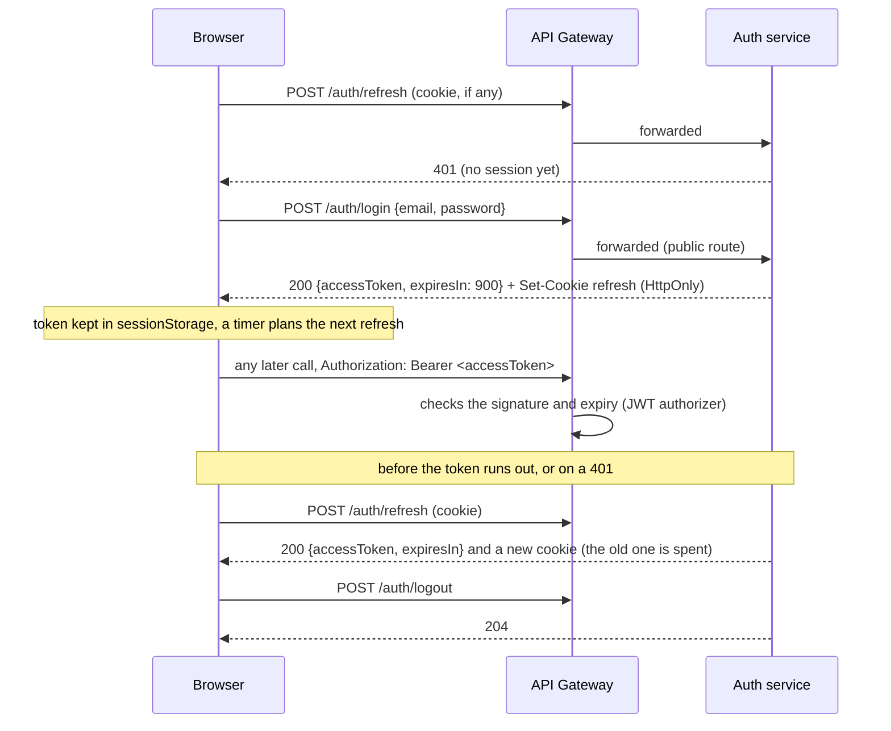

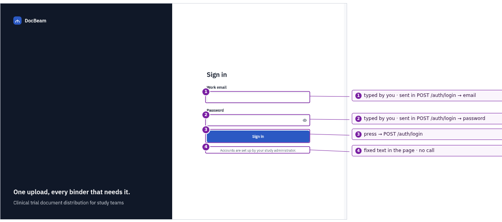

| Marker | What it is | Where it comes from |
|---|---|---|
| 1, 2 | Email, password | typed by you; sent in the body of `POST /auth/login` |
| 3 | Sign in | press → `POST /auth/login` |
| 4 | "Accounts are set up by your study administrator." | fixed text in the page; there is no sign-up (D-F1-17) |

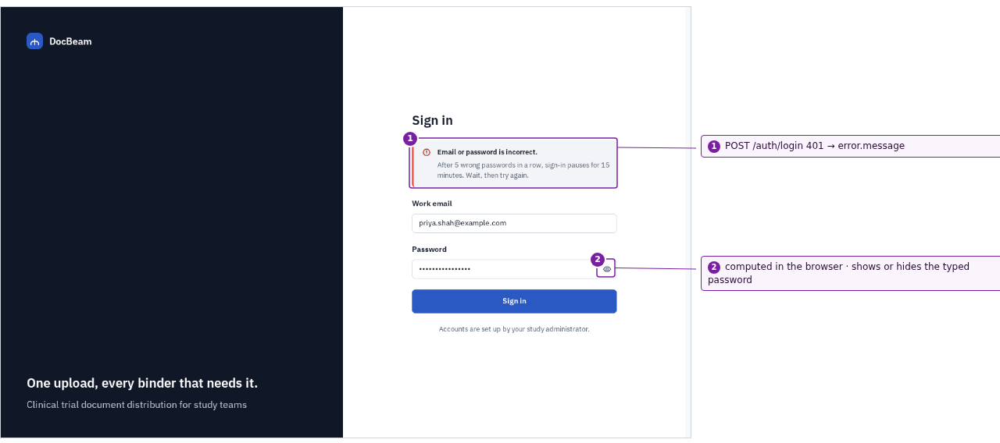

| Marker | Where it comes from |
|---|---|
| 1 | `POST /auth/login` `401` → `error.message` ("Email or password is incorrect.") |
| 2 | computed in the browser: shows or hides what was typed |

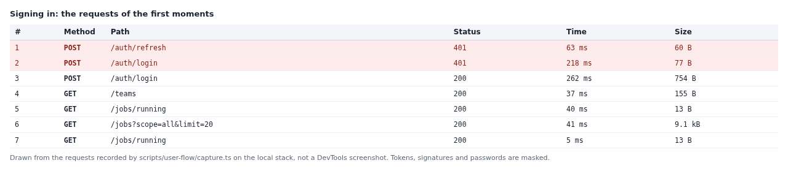

### `POST /auth/login`

*When it fires:* when **Sign in** is pressed (and in the "Sign in again" box).

*Request:* `{"email":"priya.shah@example.com","password":"<masked>"}`

*Answer, 200 (251 ms in the recording):*

```json
{ "accessToken": "<masked>", "expiresIn": 900 }
```

The refresh token arrives in a `Set-Cookie` header the page cannot read. The access token is a JWT with the person's id, name, email and expiry (`exp`); the page decodes it (without checking it) to show the name.

*Answer, 401:* `{"error":{"code":"UNAUTHORIZED","message":"Email or password is incorrect."}}`. Five wrong passwords in a row pause sign-in for 15 minutes (the page then says so).

| Field | Fills | Marker |
|---|---|---|
| `accessToken` | stored in `sessionStorage`; its claims give the name and email in the header | (header of every later screen) |
| `expiresIn` | not shown; the token's own `exp` decides when to refresh | — |
| `error.message` | the red message | 01b · 1 |

*Returned but not shown:* `expiresIn`. *Shown but computed in the browser:* the initials in the avatar, from the name in the token.

### `POST /auth/refresh`

*When it fires:* (1) at page load, when there is no usable token: one quiet attempt before showing "Sign in" (that is the first `401` in the figure above); (2) shortly before the access token runs out; (3) after any API call that answered `401`.

*Request:* no body; the refresh cookie travels with it (`credentials: include`).

*Answer, 200:* `{"accessToken":"<masked>","expiresIn":900}` and a **new** cookie. A refresh token can be used once: using an old one again ends the whole session (reuse detection, ADR-015). *Answer, 401:* `{"error":{"code":"UNAUTHORIZED","message":"Sign in again."}}`.

If several tabs are open, one of them (the one that gets the browser's Web Lock) swaps the token and tells the others through a `BroadcastChannel`, so a refresh token is never used twice.

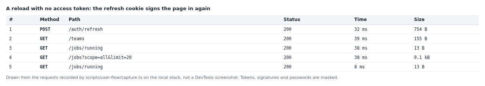

The figure shows what a reload does when the access token is gone (it is removed by hand here): `POST /auth/refresh` succeeds, then the screen's own calls follow.

### The "Sign in again" box

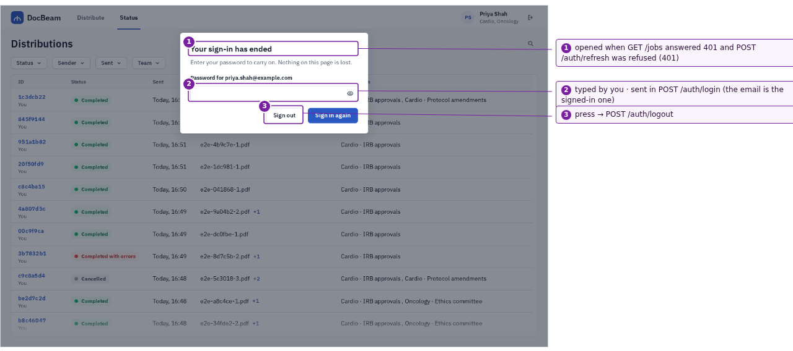

| Marker | Where it comes from |
|---|---|
| 1 | opened because `GET /jobs` answered `401` and `POST /auth/refresh` was refused (`401`) |
| 2 | typed by you; sent in `POST /auth/login` (the email is the signed-in person's) |
| 3 | press → `POST /auth/logout` |

*The two `401` answers in this picture were provoked:* the capture made both answers `401` (it cannot wait 12 hours), exactly as they would be when the session ends. The page then keeps itself as it was (files, ticks, the open distribution) and signs in again behind the box. The refresh token lasts 12 hours (ADR-015).

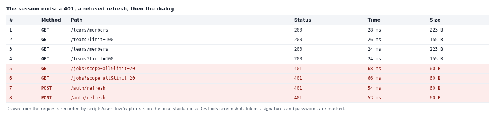

### `POST /auth/logout`

*When it fires:* on **Sign out**, or on "Sign out" in the dialog. *Request:* no body, cookie only. *Answer:* `204`, no body; the cookie is cleared. The page forgets the token, the open distribution and any files on the page.

### Why it works this way

The access token is short (15 minutes) and lives in `sessionStorage`, so stealing it gives little time and closing the tab ends it. The long-lived part, the refresh token, sits in an HttpOnly cookie that scripts cannot read, and it rotates on every use so a copied cookie is noticed (ADR-015). The API Gateway checks every API call's token itself before the call reaches a service (ADR-001).

---

## 2. Add files

### What the user does and sees

The person drops files on the page or presses **Add files**. Each file appears as a row. The page first reads the file's opening bytes and refuses anything that is not what its name says (a picture renamed `.pdf` is not added; the reason shows in a box). Accepted files go through **Uploading**, **Scanning** and **Ready**. A file in which the virus scan finds malware leaves the list by itself and is named in the same box, with "Malware was found. The file was deleted." A big file goes up in pieces. If the page is reloaded, files that are already uploaded and scanned come back.

### The calls

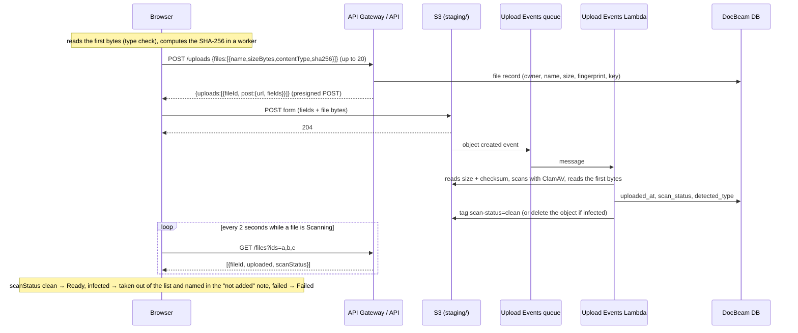

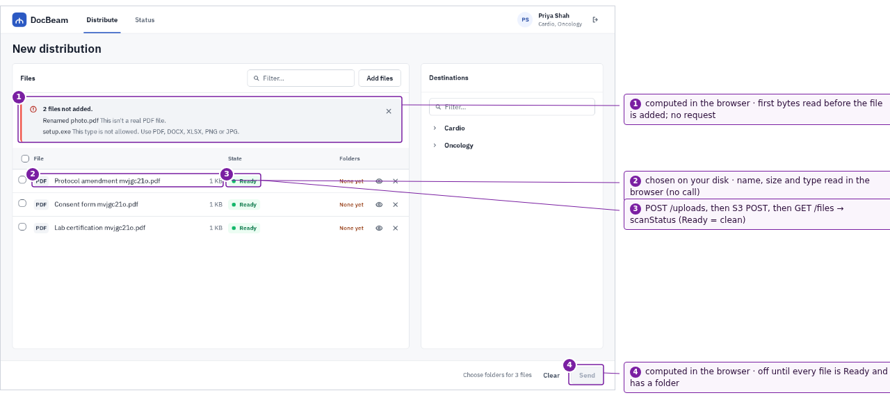

| Marker | What it is | Where it comes from |
|---|---|---|
| 1 | The "not added" box | computed in the browser: the first bytes were read before the file was added; **no request** |
| 2 | File name, type tag, size | chosen on your disk; name, size and type (from the file's contents) read in the browser; no call |
| 3 | The state chip (Ready) | `POST /uploads` → `S3 POST` → `GET /files` → `scanStatus` |
| 4 | Send (off) | computed in the browser: off until every file is Ready and has a folder |

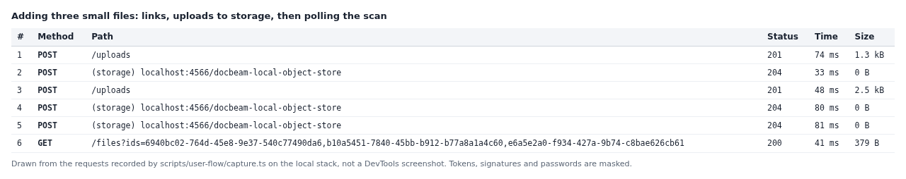

### What the page checks before and after a file is added (D-F1-81)

No call is made for these; each one puts the file in the "N files not added." box with its reason.

- **The same file again:** a file with the same name, size and last-modified time as one in the list (or earlier in the same pick) is not added: "This file is already in the list."
- **A renamed copy:** after the browser has worked out a file's SHA-256 and before it is uploaded, a second file with the same SHA-256 is taken out (the newer one, with its selection and folder ticks), and the box says "Same contents as <other file>, already in the list." It is never uploaded. A restored batch follows the same rule. Two files with the same name and different contents are both kept.
- **A long name:** a name over 255 characters is not added: "The name is longer than 255 characters."
- **Age:** each file's age counts from its row on the server (`createdAt` in `GET /files`). Checked when the page opens and about once a minute, a file older than 24 hours is taken out: "Uploaded more than 24 hours ago. Add it again."
- **Offline:** while the browser is offline an info note shows under the header and uploads wait instead of using up their retries; when the browser is back they carry on from the parts already stored, and the live connection reconnects at once.
- **The object key** of a new upload ends in the file's own name (`staging/{owner}/{fileId}/{safe name}`), so a PDF viewer with no title for the file shows the name. Older objects keep their keys; every service reads the key from the database.

### `POST /uploads`

*When it fires:* as soon as a file has been fingerprinted, in waves of at most 20 files, at most one wave in flight, so a hundred files do not ask for a hundred links at once (ADR-004).

*Request:* `{"files":[{"name":"Protocol amendment mvhterwm.pdf","sizeBytes":409,"contentType":"application/pdf","sha256":"a22bfcc8…0f0c"}]}`

*Answer, 201:* the slip shown in "Presigned links" above: for each file a `fileId` and `post: {url, fields}`. A file over 100 MiB gets `{fileId, multipart: true, partSize, partCount}` instead.

| Field | Used for |
|---|---|
| `uploads[].fileId` | the id every later call uses for this file (polling, the job) |
| `uploads[].post.url` and `.fields` | the form sent to S3 (not shown on screen) |
| `multipart`, `partSize`, `partCount` | tell the page to use the multipart calls |

*Returned but not shown:* all of it; the screen shows only what happens next. *Computed in the browser:* the type tag (from the contents), the size text.

### `S3 POST (presigned form)`

*When it fires:* right after the answer above, up to four uploads at once. *What it is:* a `multipart/form-data` POST straight to S3: the `fields` first, then the file. It is sent with `XMLHttpRequest` because the page shows progress. *Answer:* `204`, no body (28 ms for a tiny file in the recording). S3 itself enforces the policy: a wrong size, type or fingerprint is refused (`400`/`403`) and the page shows **Failed** with a reason.

### `GET /files`

*When it fires:* every 2 seconds while any file is Scanning (and once after a reload). *Request:* `GET /files?ids=<id>,<id>,…` (at most 100 ids; only the caller's own files are answered, others are left out).

*Answer, 200:*

```json
[
  { "fileId": "6c5d6b65-8c74-46a4-9333-e53bf63f7185", "uploaded": true, "scanStatus": "clean" },
  { "fileId": "21b5dcb0-a800-4fc0-a1c5-defc6e1f79ff", "uploaded": true, "scanStatus": "clean" }
]
```

| Field | Fills | Marker |
|---|---|---|
| `scanStatus` `pending` | **Scanning** | 02 · 3 |
| `scanStatus` `clean` and `uploaded` true | **Ready** | 02 · 3 |
| `scanStatus` `infected` | the file leaves the list by itself, with its selection and folder ticks, and the "not added" note names it: "Malware was found. The file was deleted." (the same sentence the upload-events worker stores) | 02b · 1 |
| `scanStatus` `failed` | **Failed** ("The scan couldn't run.") | — |

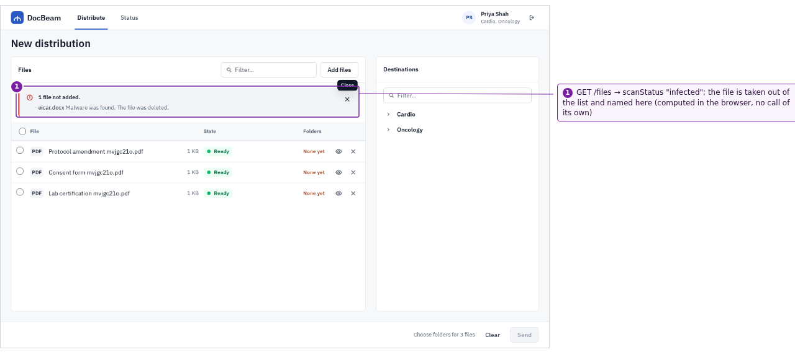

*How the page learns the state:* it **polls** this route; there is no push for uploads, because nobody has a live connection yet (the WebSocket is only for distributions that exist). The Upload Events Lambda does the work in the background: it reads the stored object's size and fingerprint, checks them against the record, scans it with ClamAV, reads the first bytes to confirm the type (`detected_type`), and either tags the object clean or deletes it and records `file.refused` (ADR-016).

### Multipart uploads (files over 100 MiB)

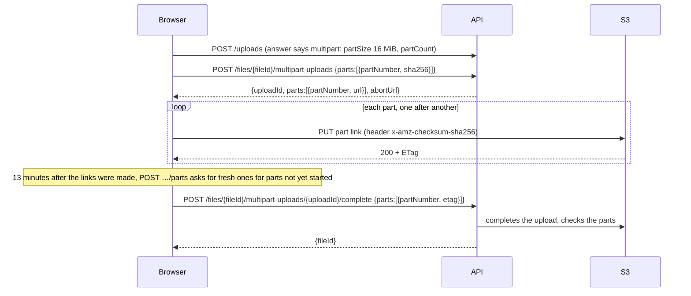

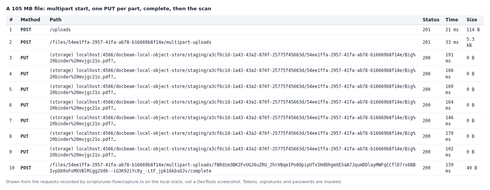

* **`POST /files/{fileId}/multipart-uploads`** — *fires* when a big file's upload starts. *Request:* the SHA-256 of every part. *Answer, 201:* `{"uploadId":"jsXsGnZh…","parts":[{"partNumber":1,"url":"http://localhost:4566/…?X-Amz-Algorithm=…&X-Amz-Expires=900&X-Amz-Signature=<masked>&partNumber=1&uploadId=…"}, …],"abortUrl":"…"}`. Each part link is signed for one part and one fingerprint and lasts 15 minutes.
* **`S3 PUT (presigned part)`** — *fires* once per part, with the fingerprint in the `x-amz-checksum-sha256` header; S3 checks it. *Answer:* `200` and an `ETag` header the page must keep. A part that fails is tried again (2, 4 and 8 seconds apart); a part that was refused ends the file as **Failed**, with **Retry**; a broken connection leaves it **Interrupted**, and **Retry** continues from the parts already stored.
* **`POST /files/{fileId}/multipart-uploads/{uploadId}/parts`** — *fires* when the links are 13 minutes old and parts remain: it asks for fresh links for the parts not yet started. *Request:* `{"parts":[{"partNumber":4,"sha256":"…"},…]}`. *Answer:* `{"parts":[{"partNumber":4,"url":"…"},…]}`. The recording is a few seconds long, so this call did not need to fire; its shape is as above.
* **`POST /files/{fileId}/multipart-uploads/{uploadId}/complete`** — *fires* after the last part. *Request:* `{"parts":[{"partNumber":1,"etag":"\"dbcc6b6c…\""}, …]}`. *Answer, 200:* `{"fileId":"c1f081d2-…"}`. S3 joins the parts; the scan follows as for a small file.
* **`S3 DELETE (multipart abort link)`** — *fires* when a multipart file is removed while it is still going: the page calls the `abortUrl` from the start answer so S3 does not keep the stored parts. It is a plain `DELETE` to S3 with no answer the page reads.

### Reload keeps the files

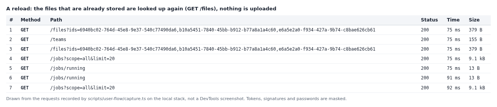

The page keeps the batch (file ids, names, sizes, types, fingerprints, the folder ticks) in `sessionStorage`. After a reload it asks `GET /files?ids=…` once for the files that had finished uploading: stored and clean come back **Ready**, still scanning come back **Scanning**, and ones that are gone, refused or were still uploading are dropped with "N files could not be restored". A file that was mid-upload cannot come back: the browser cannot read a file from disk again by itself (D-F1-66).

### Why it works this way

Files go straight to S3 and are checked there (ADR-002); they are confirmed and scanned in the background right after upload so that nothing unscanned can be submitted (ADR-016); links last 15 minutes and are asked for in waves of 20 (ADR-004). The first-bytes check in the browser spares a round trip for a file that can never be accepted, and the same check runs again on the server (D-F1-44).

---

## 3. Choose folders

### What the user does and sees

On the right, **Destinations** shows the person's own teams. They open a team, then a binder, then folders, and tick the folders the files should go to. Only folders can be ticked; teams and binders are headings. A box above the tree searches: one letter narrows what is already open; two letters or more look in every folder of the person's teams and list the matches with their path; picking one ticks it and opens the tree to it.

### The calls

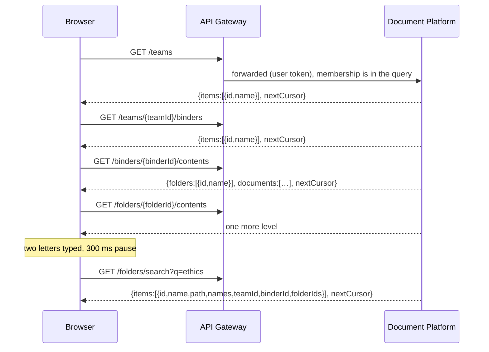

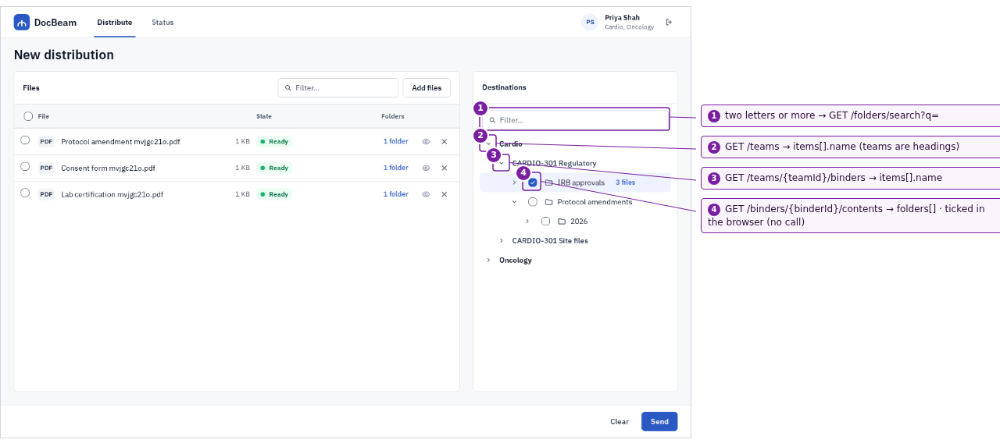

| Marker | What it is | Where it comes from |
|---|---|---|
| 1 | The box "Filter…" | typed by you; from 2 characters → `GET /folders/search?q=` |
| 2 | Team names (Cardio, Oncology) | `GET /teams` → `items[].name` |
| 3 | A binder (CARDIO-301 Regulatory) | `GET /teams/{teamId}/binders` → `items[].name` |
| 4 | The folders (IRB approvals, Protocol amendments) | `GET /binders/{binderId}/contents` → `folders[]`; the tick is made in the browser, no call |

*(The deeper folder "2026" in this picture comes from `GET /folders/{folderId}/contents`, one level below "Protocol amendments".)*

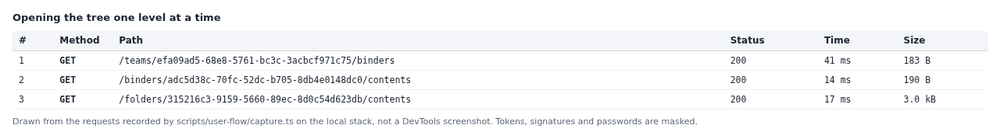

### `GET /teams`

*When it fires:* when Distribute opens (the first level of the tree), and again by Status for its filters (`?limit=100`). *Answer, 200:*

```json
{ "items": [ { "id": "efa09ad5-…", "name": "Cardio" }, { "id": "a6578412-…", "name": "Oncology" } ], "nextCursor": null }
```

A person sees only their own teams: membership is part of the query (ADR-006). Up to 50 per page; the page asks for the next with `?cursor=` (`nextCursor`) when the list scrolls. `items[].name` fills the team rows and the team names in the header (computed from this list in the browser).

### `GET /teams/{teamId}/binders`, `GET /binders/{binderId}/contents`, `GET /folders/{folderId}/contents`

*When they fire:* when a row is opened, one level at a time, 20 rows per page and the next page when the list is scrolled to its end (`?cursor=`). *Answers:*

```json
{ "items": [ { "id": "adc5d38c-…", "name": "CARDIO-301 Regulatory" } ], "nextCursor": null }
{ "folders": [ { "id": "f262f30b-…", "name": "IRB approvals" }, { "id": "315216c3-…", "name": "Protocol amendments" } ], "documents": [], "nextCursor": null }
```

A team or binder that is not the caller's answers `404`, the same as one that does not exist. `documents` is returned but **not shown**: documents are not destinations, so the tree keeps only `folders` (and does not read further pages once a page holds a document, because folders come first).

### `GET /folders/search`

*When it fires:* from 2 characters typed in the box, 300 ms after the last keystroke (one request per word, not per letter). The results are in path order, team then binder then folder, with numbers in natural order ("Team 2" before "Team 10"), the same order as the tree; "Show more" continues in that order (D-F1-81).

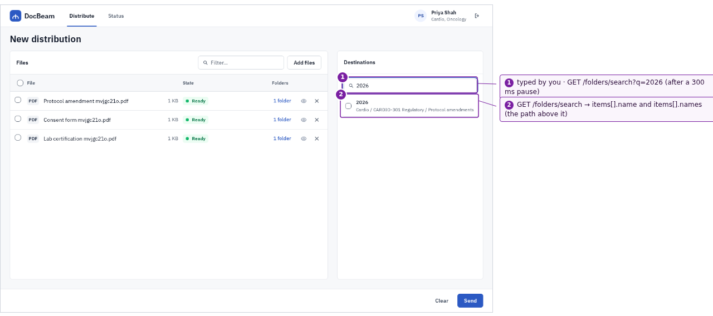

| Marker | Where it comes from |
|---|---|
| 1 | typed by you; `GET /folders/search?q=2026` |
| 2 | `GET /folders/search` → `items[].name` (the folder) and `items[].names` (the path above it) |

*Answer, 200:*

```json
{
  "items": [ {
    "id": "e4631be3-…", "name": "Ethics committee",
    "path": "Oncology / ONC-118 Regulatory / Ethics committee",
    "names": ["Oncology", "ONC-118 Regulatory", "Ethics committee"],
    "teamId": "a6578412-…", "binderId": "5058b459-…", "folderIds": ["e4631be3-…"]
  } ],
  "nextCursor": null
}
```

`name` and `names` fill the result row; `teamId`, `binderId` and `folderIds` (top down, the match last) are **returned but not shown**: they let the page open the tree down to the folder when it is picked, loading each level it needs. The search covers only the caller's teams, is case-insensitive, needs 2 to 100 characters (otherwise `400`), and is served by a trigram index (D-F1-67).

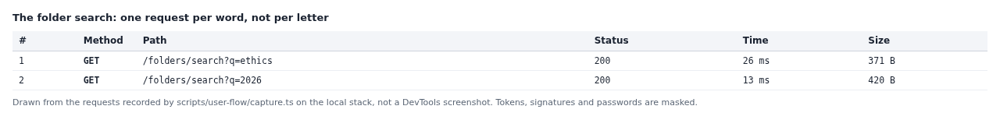

### Why it works this way

One level at a time with membership in every query means a person never sees (or downloads the names of) a team they are not in, and a team with thousands of folders is never loaded whole (ADR-006, ADR-010). Ticking is a choice in the page; nothing is sent until Send.

---

## 4. Send

### What the user does and sees

With every file Ready and a folder ticked for each, **Send** turns on. Pressing it asks one question ("Send 3 files to 2 folders?") because delivered files cannot be recalled. **Send** in the box creates the distribution and the page opens it on Status, where the deliveries appear as pending and then run.

### The calls

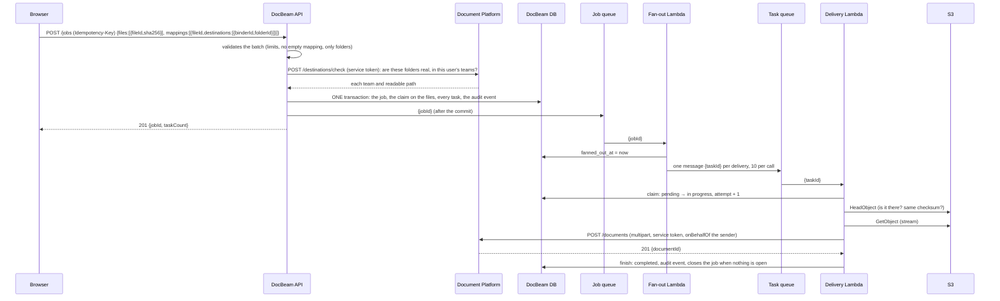

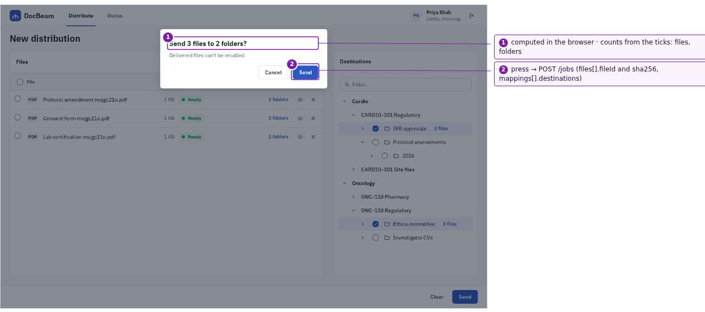

| Marker | Where it comes from |
|---|---|
| 1 | computed in the browser: counts of files and folders from the ticks |
| 2 | press → `POST /jobs` (`files[].fileId` and `sha256`, `mappings[].destinations`) |

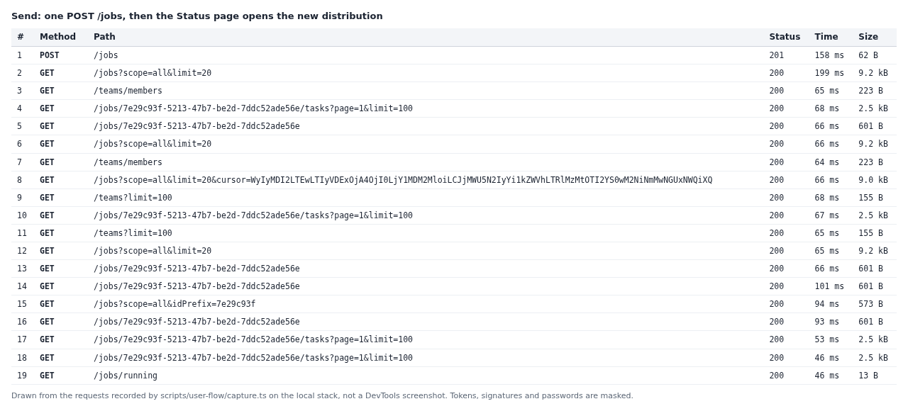

### `POST /jobs`

*When it fires:* when **Send** is pressed in the question. *Headers:* `Idempotency-Key` (a random id made once per attempt; sending the same request again returns the same distribution with `200` instead of a second one).

*Request (shortened):*

```json
{
  "files": [ { "fileId": "6c5d6b65-…", "sha256": "a22bfcc8…0f0c" }, … ],
  "mappings": [ { "fileId": "6c5d6b65-…", "destinations": [ { "binderId": "adc5d38c-…", "folderId": "f262f30b-…" }, { "binderId": "5058b459-…", "folderId": "e4631be3-…" } ] }, … ]
}
```

*Answer, 201 (170 ms in the recording):* `{"jobId":"b7fbb68d-3f17-4460-9e7b-dc11a3908d76","taskCount":6}`

| Field | Fills | Marker |
|---|---|---|
| `jobId` | the address of the Status page, the first 8 characters in the heading (computed in the browser) | 04b · 1 |
| `taskCount` | not shown (the Status page counts the deliveries itself) | — |

**What the server checks (every one is an error code the page can show):** at least 1 and at most 100 files; no file twice; every file mapped to at least one **folder** (not a binder); no two files with the same SHA-256 (422 `INVALID_BATCH`, "Two files in this distribution have the same contents."); at most 20 folders ("A distribution can have at most 20 folders." — on Destinations the 21st folder cannot be ticked, with that sentence as its tooltip); at most 2,000 deliveries; each per-file refusal names the file ("Protocol amendment 3.pdf was uploaded more than 24 hours ago. Add it again."); every file belongs to the caller, is uploaded and **clean**, is less than 24 hours old and is not already in a distribution; every folder exists and is in a team the caller belongs to (asked of the platform, never trusted from the browser). The batch rules live in one shared function, so the page and the server agree.

**What it stores, in one transaction:** a row in `jobs` (who, when, how many deliveries, the idempotency key), the claim on the files (`files.job_id`), one row in `tasks` per file and folder (pending, with the destination path as it was then), and an `audit_events` row `job.submitted`. Straight after the recording of Send, the database held this for the new distribution:

```json
{ "job": [ { "task_count": 6, "fanned_out": false } ], "tasksByStatus": [ { "status": "pending", "n": 6 } ] }
```

*(the workers were held for this picture, so the deliveries had not started).* After the commit the API puts `{"jobId": …}` on the **Job queue**. If that fails, the job still exists, and a sweeper sends the message again within minutes (ADR-014).

*Errors, as recorded (sent by the capture script, because the page checks first):*

| Status | Body | When |
|---|---|---|
| 422 | `{"error":{"code":"INVALID_BATCH","message":"Add at least one file."}}` | an empty batch |
| 422 | `{"error":{"code":"INVALID_BATCH","message":"Every file needs at least one destination."}}` | a file with no folder |
| 400 | `{"error":{"code":"IDEMPOTENCY_KEY_REQUIRED","message":"Send an Idempotency-Key header."}}` | no key |

### From the queue to the delivery

* **Fan-out Lambda.** It reads `{jobId}`, sets `jobs.fanned_out_at`, and sends one message `{"taskId": …}` per pending task to the **Task queue**, ten per call. Repeating it is safe: a message for a finished task stops at the claim (ADR-008).
* **Delivery Lambda** (up to 50 at once). For each message it **claims** the task in one statement (so a repeated message does nothing), checks that the staged object exists and has the declared fingerprint, **streams** it from S3 to the platform's `POST /documents` as a multipart form (fields: task, binder, folder, name, content type, fingerprint, `onBehalfOf` the sender; header: a service token), and records the outcome. The platform checks again that the sender is in the team, the folder exists, the type matches and the fingerprint matches, and stores the document once per task. A temporary problem (the platform down, busy or slow) puts the message back after 30 seconds, then 2, 5 and 10 minutes; a permanent one (the folder is gone, the sender left the team) fails the delivery with a reason. When nothing is open any more, the job is closed (`completed_at`).
* Each outcome is **pushed over the WebSocket** to anyone watching (chapter 5).

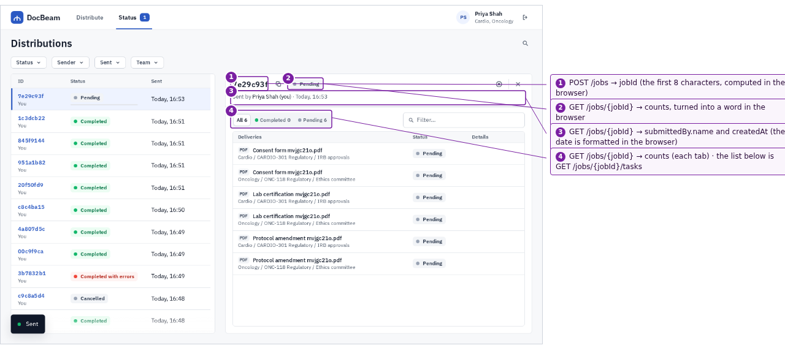

| Marker | Where it comes from |
|---|---|
| 1 | `POST /jobs` → `jobId` (first 8 characters, computed in the browser) |
| 2 | `GET /jobs/{jobId}` → `counts`, turned into a word ("Pending") in the browser |
| 3 | `GET /jobs/{jobId}` → `submittedBy.name` and `createdAt` (the date is formatted in the browser) |
| 4 | `GET /jobs/{jobId}` → `counts` (one number per tab); the rows below are `GET /jobs/{jobId}/tasks` |

### Why it works this way

The submit does the cheap, certain things (checks, one transaction) and leaves the slow ones to queues, so a distribution of 2,000 deliveries is accepted in tens of milliseconds and is never lost half-way (ADR-005, ADR-008). The queue between the API and the workers survives a crash on either side. The platform is asked again at delivery time, so a person removed from a team after sending cannot still deliver (a documented failure, chapter 5).

---

## 5. Watch it

### What the user does and sees

**Status** lists everything the person can see, newest first, with filters (Status, Sender, Sent, Team). A badge on the tab counts distributions still running. Opening one shows a panel: a status chip, who sent it and when, tabs with counts (All, Completed, Failed, In progress, Pending, Cancelled) and one row per delivery. Numbers and chips change by themselves while it runs. A delivery that is trying again shows **Retrying**. The sender can **Cancel distribution** while deliveries wait and **Retry failed** when some failed.

### The calls

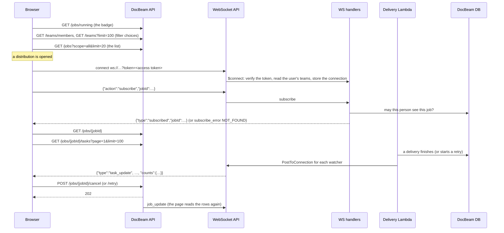

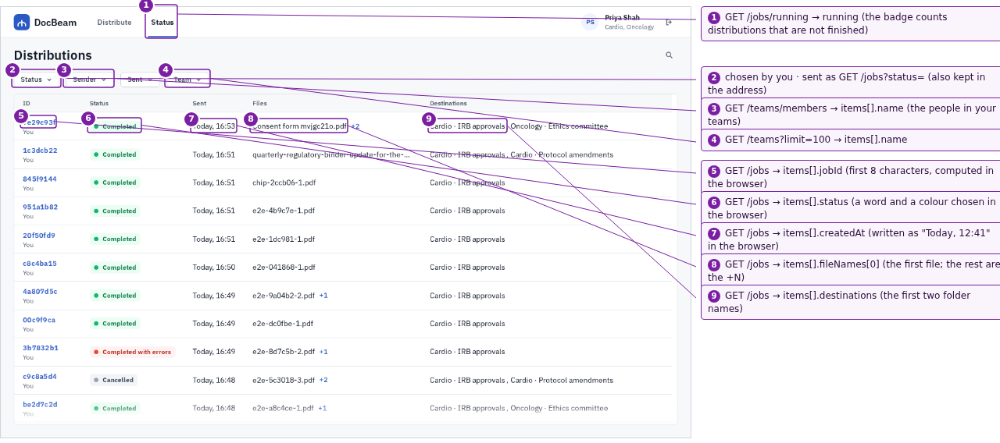

| Marker | What it is | Where it comes from |
|---|---|---|
| 1 | The badge on Status | `GET /jobs/running` → `running` |
| 2 | The Status filter | chosen by you; sent as `GET /jobs?status=` (and kept in the address) |
| 3 | The Sender filter | `GET /teams/members` → `items[].name` |
| 4 | The Team filter | `GET /teams?limit=100` → `items[].name` |
| 5 | ID (and the sender under it) | `GET /jobs` → `items[].jobId` (first 8 characters, computed) and `submittedBy.name` ("You" is computed from `userId`) |
| 6 | The status chip | `GET /jobs` → `items[].status` (the word and the colour are chosen in the browser) |
| 7 | Sent | `GET /jobs` → `items[].createdAt` (written as "Today, 12:41" in the browser) |
| 8 | Files | `GET /jobs` → `items[].fileNames[0]` (the first file; the rest are the "+N") |
| 9 | Destinations | `GET /jobs` → `items[].destinations` (the first two folders, each as "team · folder" from its path; the full path is the tooltip) |

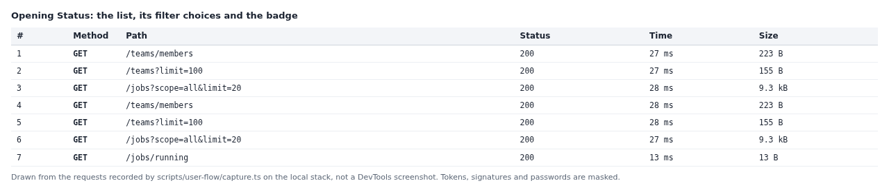

### What changed in the last round (D-F1-81)

- **Filters in the address that do not apply to the person are dropped** once their teams and colleagues have loaded (the list waits for them, so a slow load never drops a valid filter): a team they are not in, a sender who is not them or in their teams. The address is replaced, with no new history entry, and the list shows as if the link did not have them. A status or time the page does not know is also taken out of the address. The Team button shows only for a person in more than one team. "Sender: Me" is stored as the person's own id (an old `sender=me` still works): the person it belongs to sees "Me", a colleague sees the name, and a person who shares no team with them has it dropped.
- **The Destinations cell** shows each of the first two folders as "<team> · <folder>", with the full path as its tooltip.
- **One file order:** the first file in a row, the "+N" popover and the panel's deliveries all go by file name.
- **Opening a distribution:** the live subscribe, `GET /jobs/{jobId}` and the first page of deliveries go out together. A distribution that was still running is read once more after the subscribe answers, so nothing is missed.
- **The retry window:** for the sender, when deliveries failed and Retry can no longer help, an info note under the header says "Retry has ended (24 hours after this finished). Send the files again as a new distribution." (or, for a cancelled one, "This distribution was cancelled. …"), from the `retry` state the API already returns.
- **Everywhere:** counts have a thousands separator; error toasts stay until closed (at most 3 toasts, the oldest goes first), success toasts fade after 4 seconds and wait while the pointer is over them; the tab title follows the page ("Status · DocBeam", "3d63d20e · Status · DocBeam"); a tooltip shows on hover and on keyboard focus only (a dialog opening closes any open tooltip); the two "Copy link" buttons are "Copy link to <id>" and the other repeated buttons carry the file or folder in their names.

### The list

**`GET /jobs`** — *fires* when Status opens, when a filter changes (`?status=completed`, `?sender=<userId>`, `?sentSince=`, `?team=<teamId>`, `?scope=all|mine|team`), when the next 20 are needed (`?cursor=`, as the list is scrolled), and for Open by ID (`?idPrefix=`). *Answer, 200 (shortened):*

```json
{
  "items": [ {
    "jobId": "70912bba-6ff8-4e50-b2a6-dda557de6216",
    "submittedBy": { "userId": "a3cf6c1d-…", "name": "Priya Shah" },
    "createdAt": "2026-10-21T07:58:44.566Z",
    "taskCount": 6, "fileCount": 3, "destinationCount": 2,
    "fileNames": ["Protocol amendment mvhtknnl.pdf", "Consent form mvhtknnl.pdf", "Lab certification mvhtknnl.pdf"],
    "destinations": ["Cardio / CARDIO-301 Regulatory / IRB approvals", "Oncology / ONC-118 Regulatory / Ethics committee"],
    "counts": { "pending": 0, "in_progress": 0, "completed": 6, "failed": 0, "cancelled": 0 },
    "status": "completed"
  } ],
  "nextCursor": "…"
}
```

*Returned but not shown:* `taskCount` (used for the progress bar while running), `fileCount` and `destinationCount` (the page counts the lists it has). *Shown but computed:* the first 8 characters of the id, "You", the date text, the chip's word and colour, the "+N". The list is ordered newest first with a keyset cursor on `(created_at, id)`, so a new distribution never shifts or repeats a row (D-F1-40).

A filter is just another request:

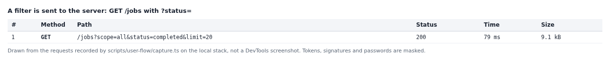

**`GET /jobs/running`** — *fires* when Status opens and after changes. *Answer:* `{"running":0}`: how many of the caller's distributions have a pending or running delivery. It fills the badge (and only that).

**`GET /teams/members`** and **`GET /teams?limit=100`** — *fire* once for the filter menus. `members` is `{"items":[{"userId":"…","name":"Anantim Patil"},…]}` (the people who share a team with the caller, once each, by name); the `teams` answer is the one shown in chapter 3.

### The panel

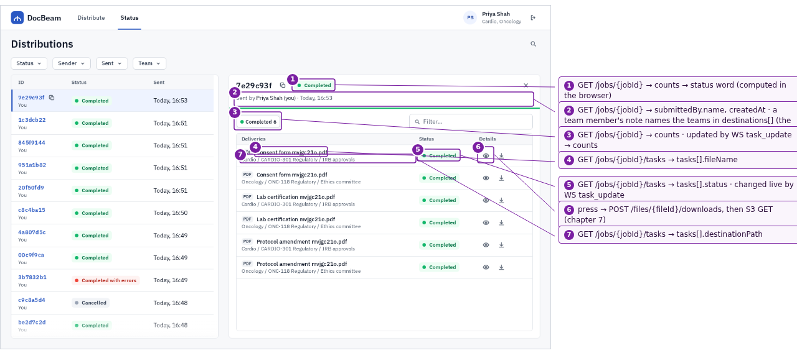

| Marker | Where it comes from |
|---|---|
| 1 | `GET /jobs/{jobId}` → `counts` → the status word (computed in the browser) |
| 2 | `GET /jobs/{jobId}` → `submittedBy.name`, `createdAt`; for a team member the note names the teams found in `destinations[]` (the folder paths of the deliveries they may see), with no extra call |
| 3 | `GET /jobs/{jobId}` → `counts` (each tab); updated live by `WS task_update` → `counts` |
| 4 | `GET /jobs/{jobId}/tasks` → `tasks[].fileName` |
| 5 | press → `POST /files/{fileId}/downloads`, then `S3 GET` (chapter 7) |
| 6 | `GET /jobs/{jobId}/tasks` → `tasks[].status`; changed live by `WS task_update` |
| 7 | `GET /jobs/{jobId}/tasks` → `tasks[].destinationPath` |

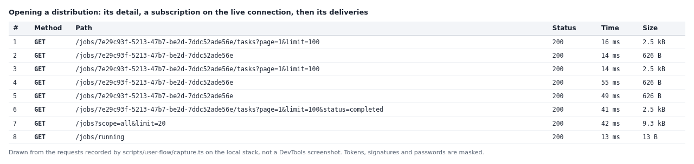

**`GET /jobs/{jobId}`** — *fires* when a distribution is opened, and again after a reconnect. *Answer, 200:*

```json
{
  "asOf": "2026-10-21T07:54:10.365Z",
  "jobId": "b7fbb68d-3f17-4460-9e7b-dc11a3908d76",
  "submittedBy": { "userId": "a3cf6c1d-…", "name": "Priya Shah" },
  "createdAt": "2026-10-21T07:54:10.175Z", "completedAt": null, "cancelledAt": null,
  "isSender": true,
  "destinations": ["Cardio / CARDIO-301 Regulatory / IRB approvals", "Oncology / ONC-118 Regulatory / Ethics committee"],
  "taskCount": 6,
  "counts": { "pending": 6, "in_progress": 0, "completed": 0, "failed": 0, "cancelled": 0 },
  "status": "pending",
  "fileCount": 3,
  "retry": { "open": false, "retryable": 0, "reason": "NOTHING_TO_RETRY" },
  "cancel": { "open": true, "waiting": 6 }
}
```

| Field | Fills |
|---|---|
| `counts` | the tab numbers and, with `cancelledAt`, the status chip (05b · 1, 3) |
| `submittedBy.name`, `createdAt` | the "Sent by" line (05b · 2) |
| `isSender` | whether the buttons and the "(you)" show; a team member gets a note instead |
| `retry.open`, `retry.retryable` | whether **Retry failed** is on (05d · 2) |
| `cancel.open`, `cancel.waiting` | whether **Cancel distribution** is on, and the number in its question |
| `asOf` | not shown: the server's clock, so a push older than this answer is ignored |

*Returned but not shown:* `completedAt`, `destinations`, `taskCount`, `fileCount`. The status is **worked out** from the counts by one rule shared with the browser (pending only if nothing has started; in progress if anything is open; otherwise completed, with errors if any failed; cancelled once nothing is open and it was cancelled), so a push can change the chip without a request. A distribution with no deliveries at all is never "completed" (D-F1-62).

**`GET /jobs/{jobId}/tasks`** — *fires* after the subscription is confirmed, 100 rows per page (`?page=`, `?limit=`), optionally `?status=`; later pages are read as the table scrolls (only the pages the rows in view need). *Answer, 200 (shortened):*

```json
{
  "page": 1, "limit": 100, "total": 6,
  "tasks": [ {
    "taskId": "a448be93-…", "fileId": "21b5dcb0-…", "fileName": "Consent form mvhterwm.pdf",
    "destinationPath": "Cardio / CARDIO-301 Regulatory / IRB approvals", "teamId": "efa09ad5-…",
    "status": "pending", "attemptCount": 0, "failureCode": null, "failureReason": null,
    "updatedAt": "2026-10-21T07:54:10.175Z", "fileExpired": false, "fileType": "application/pdf"
  } ]
}
```

| Field | Fills |
|---|---|
| `fileName`, `fileType` | the file name and the type tag (05b · 4) |
| `destinationPath` | the grey path under the name (05b · 7) |
| `status`, `attemptCount` | the chip: "Pending", "In progress", "Completed", "Failed", "Cancelled", or **Retrying** when it is pending or running and `attemptCount` is above 1 (05b · 6) |
| `failureCode` | the sentence in the tooltip (one reason for every code, in the browser); never shown raw |
| `fileExpired` | an info icon instead of Preview and Download (chapter 7) |
| `updatedAt` | not shown: it orders a row against a later push |

*Returned but not shown:* `taskId`, `teamId`, `failureReason` (the platform's own words are not repeated; the page's sentence is shown).

### Live updates: the WebSocket

**`WS connect`** — *fires* when a distribution is opened (one connection per page). The address is the WebSocket API's, with the access token in the query string (`ws://…?token=<masked>`), because browsers cannot set headers on the handshake. The `$connect` handler verifies the token, reads the person's teams from the platform and stores the connection with the token's expiry; after that expiry nothing is pushed to it, so someone removed from a team stops seeing updates within 15 minutes. A new token means a new connection.

**`WS send subscribe`** — `{"action":"subscribe","jobId":"b7fbb68d-…"}`. The page waits for the answer before it asks for the rows, so nothing can happen between the rows being read and the first push.

**`WS receive subscribed`** — `{"type":"subscribed","jobId":"…"}`. **`WS receive subscribe_error`** — `{"type":"subscribe_error","jobId":"…","code":"NOT_FOUND"}` (the same answer for a distribution that does not exist and one the person may not see; `VALIDATION_ERROR` and `UNAVAILABLE` also exist). The page shows "not found" (chapter 6).

**`WS receive task_update`** — pushed by the Delivery Lambda or the DLQ consumer whenever a delivery finishes, and by the Delivery Lambda when a delivery **starts a second try or later** (so "Retrying" appears live, D-F1-65). One small message per update, at most one per attempt:

```json
{ "type": "task_update", "jobId": "259fa215-…", "taskId": "88ed8dfa-…", "status": "completed",
  "attemptCount": 1, "updatedAt": "2026-10-21T08:07:57.368Z",
  "counts": { "pending": 1, "in_progress": 0, "completed": 5, "failed": 0, "cancelled": 0 } }
```

`status` is `completed`, `failed` (with `failureCode`) or `in_progress` (with `attemptCount`). `counts` are fresh totals for **what this viewer may see** (the sender sees the whole job; a team member only their teams' deliveries). The page changes the row, the tab numbers and the chip from it, with no request. A message older than what a row already shows is ignored (messages can arrive out of order).

**`WS receive job_update`** — `{"type":"job_update","jobId":"…","updatedAt":"…","counts":{…}}`, sent by the API after a cancel or a retry: it carries counts and no task, so the page reads the rows again. After a dropped connection the page reconnects, subscribes again and reads the rows once more, so nothing is missed (ADR-007).

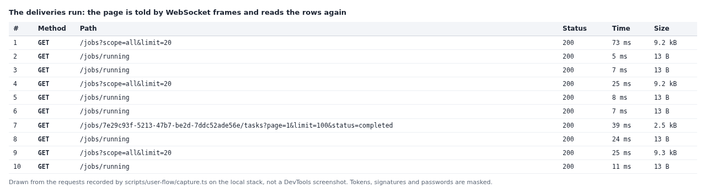

### Cancel and Retry

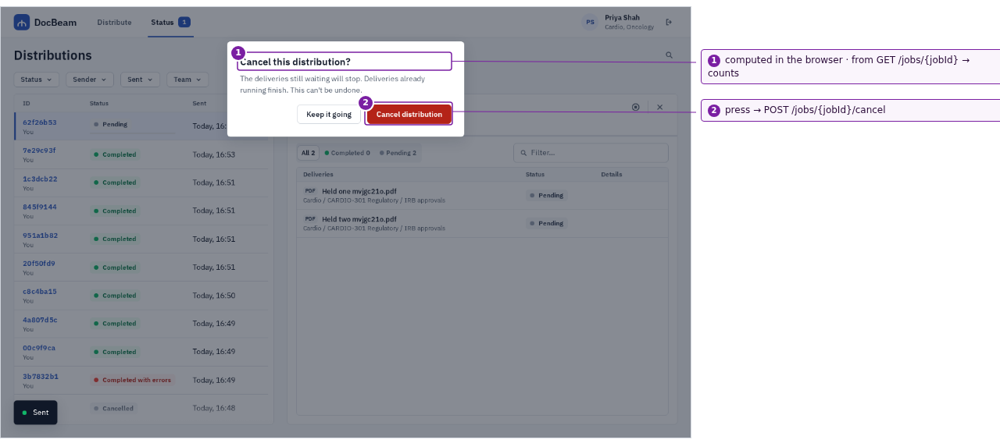

| Marker | Where it comes from |
|---|---|
| 1 | computed in the browser from `GET /jobs/{jobId}` → `counts` (how many deliveries have not started) |
| 2 | press → `POST /jobs/{jobId}/cancel` |

**`POST /jobs/{jobId}/cancel`** — *fires* from the question above (sender only, while deliveries wait). No body. *Answer, 202:* `{"cancelled":2}`: in one transaction every delivery that has not started is marked failed with the code `CANCELLED` (shown as **Cancelled**); a delivery already running is left to finish. A person who is not the sender gets `404` (if they cannot see it) or `403 NOT_SENDER`. Then the page reads the distribution again.

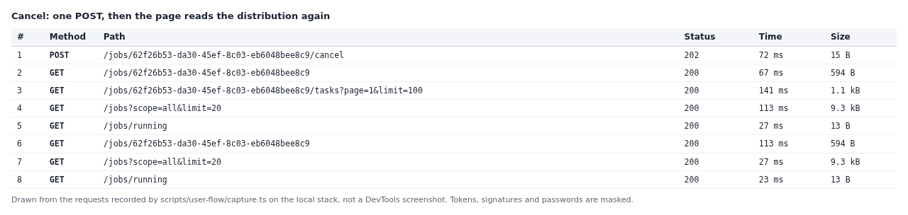

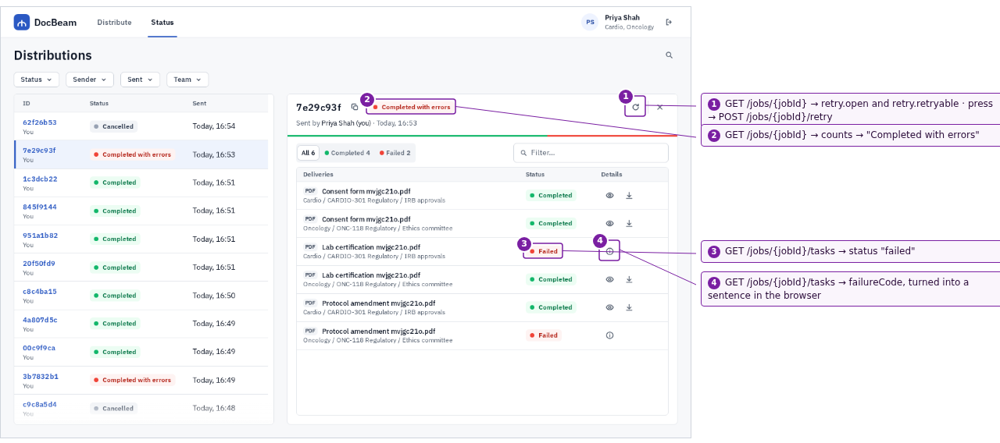

| Marker | Where it comes from |
|---|---|
| 1 | `GET /jobs/{jobId}` → `counts` → "Completed with errors" |
| 2 | `GET /jobs/{jobId}` → `retry.open` and `retry.retryable`; press → `POST /jobs/{jobId}/retry` |
| 3 | `GET /jobs/{jobId}/tasks` → `status` "failed" |
| 4 | `GET /jobs/{jobId}/tasks` → `failureCode`, turned into a sentence in the browser |

*(Two deliveries of this distribution were made to look like ones that ran out of retries, by a database edit; the rest of the picture is real.)*

**`POST /jobs/{jobId}/retry`** — *fires* from **Retry failed** (sender only; allowed within 24 hours of the first finish while every file is under 2 days old). No body. *Answer, 202:* `{"retried":2}`: the deliveries that ran out of retries go back to pending and are sent to the queue again. Deliveries that failed for a permanent reason (the folder is gone, the file never uploaded) are not retried.

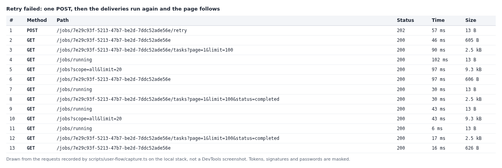

### A failed list load

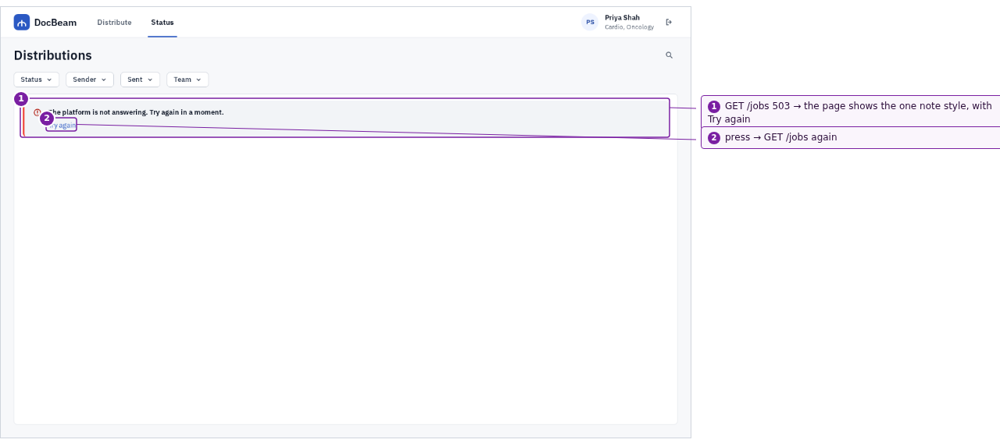

| Marker | Where it comes from |
|---|---|
| 1 | `GET /jobs` `503` → the page says it in its own words, never the server's text |
| 2 | press → `GET /jobs` again |

*This `503` was provoked:* the capture made the answer `503`, as when the platform is not answering (`{"error":{"code":"PLATFORM_UNAVAILABLE","message":"The platform is not answering. Try again in a moment."}}`). The list needs the platform to know the person's teams.

### Why it works this way

The sender and the team members watch the same distribution, and a delivery can take minutes: polling every few seconds from every open page would be wasteful and slow, so the server pushes (ADR-007). A push is only an optimisation: the page always reads the true state with `GET` first and again after any reconnect, so a lost push is never wrong for long. The status is worked out from counts and never stored, so it cannot disagree with them.

---

## 6. A team member's view, and "not found"

### What the user does and sees

Raj is in the Cardio team only. He opens the link of Priya's distribution and sees only the deliveries to Cardio folders, with counts for those. Sam is in Neuro only. He opens the same link and sees "Distribution not found", the same answer as for an address that does not exist, so he cannot even tell that it exists.

### The calls

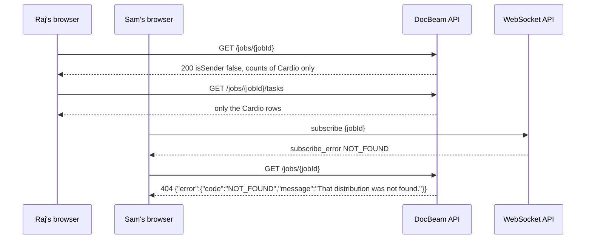

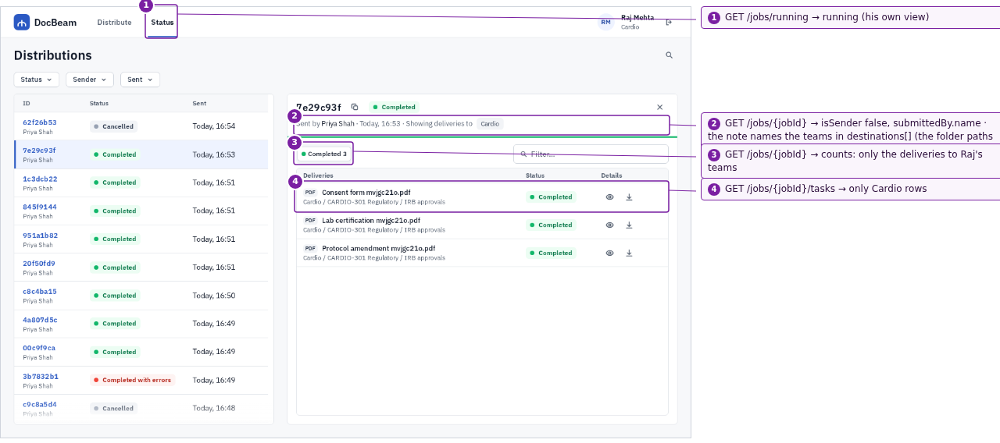

| Marker | Where it comes from |
|---|---|
| 1 | `GET /jobs/running` → `running` (his own distributions and the ones sent to his teams) |
| 2 | `GET /jobs/{jobId}` → `isSender` false and `submittedBy.name`; the note names the teams in `destinations[]` (the folder paths of the deliveries Raj may see), with no extra call |
| 3 | `GET /jobs/{jobId}` → `counts`: only the deliveries to Raj's teams |
| 4 | `GET /jobs/{jobId}/tasks` → only Cardio rows |

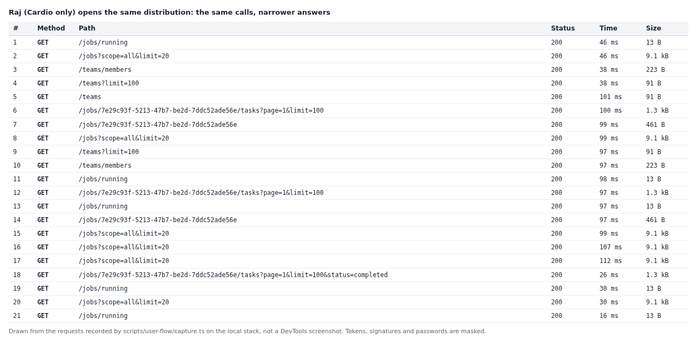

The calls are the same as in chapter 5; the **answers** are narrower. The server decides, per request, which deliveries the caller may see: the sender sees all; anyone else sees the deliveries to their own teams (the teams come from the platform, cached for about a minute). Raj gets no **Cancel** or **Retry** (`isSender` is false) and no "(you)".

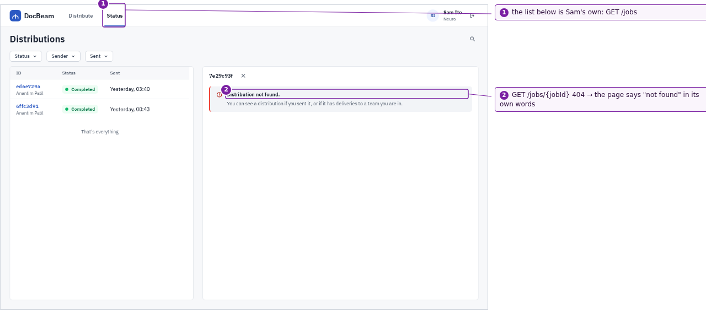

| Marker | Where it comes from |
|---|---|
| 1 | the list below is Sam's own: `GET /jobs` |
| 2 | `GET /jobs/{jobId}` `404` → the page says "Distribution not found" in its own words |

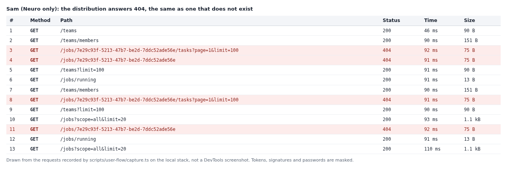

*Not found:* `GET /jobs/{jobId}` answers `404 NOT_FOUND` (the same body for a distribution that does not exist: shown as the recorded error in the table below), and the WebSocket answers `subscribe_error` with `NOT_FOUND`. Someone in none of the destination teams cannot learn that the distribution exists. A person removed from a team while watching stops receiving pushes when their connection's token expires, within 15 minutes.

*A distribution that does not exist* (sent by the capture script): `GET /jobs/00000000-0000-4000-8000-000000000002` → `404` `{"error":{"code":"NOT_FOUND","message":"That distribution was not found."}}`.

### Why it works this way

Visibility is part of every query (ADR-006), so there is no way to ask for something and be told "forbidden"; a stranger and a typo get the same `404`. Counts and rows both go through the same filter, so a viewer's numbers always add up to their rows.

---

## 7. Preview and download

### What the user does and sees

On a delivered row, the eye opens **Preview** (the file shows in the page: PDF, Word, Excel, images) and the arrow **Download** (the browser saves it under its original name). A small notice says the link lasts two minutes. A file older than 33 days shows an info icon instead: storage has deleted it, but the delivered copy is still in the team folder.

### The calls

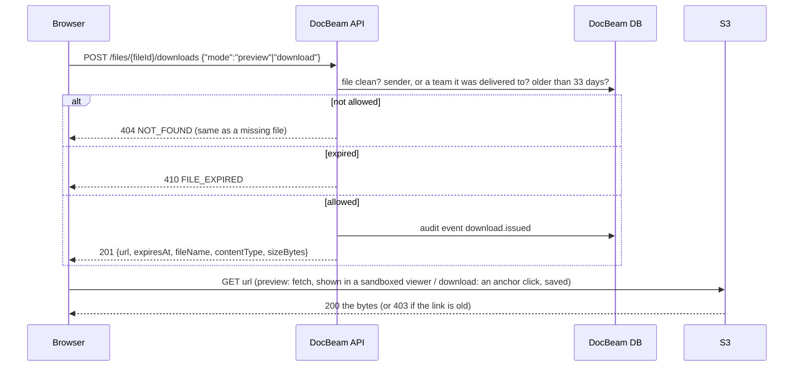

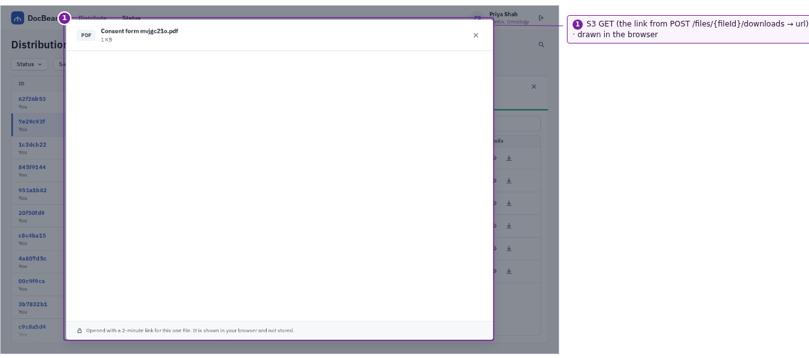

| Marker | Where it comes from |
|---|---|
| 1 | `S3 GET` of the link in `POST /files/{fileId}/downloads` → `url`; the file is drawn in the browser |

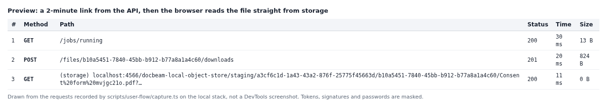

### `POST /files/{fileId}/downloads`

*When it fires:* every click of Preview or Download asks for a **new** link (never an old one). *Request:* `{"mode":"preview"}` or `{"mode":"download"}` (`400` for any other value). *Answer, 201 (32 ms in the recording):* the answer shown in "Presigned links" above.

| Field | Fills |
|---|---|
| `url` | the address the page reads (preview) or opens (download); not shown |
| `expiresAt` | the "this link works for another 1:42" notice (computed against the clock in the browser) |
| `fileName` | the preview's heading, and the name the browser saves under |
| `contentType`, `sizeBytes` | choose how the preview draws the file; not shown as text |

*The checks, in this order* (so a stranger never learns that a file exists): the file must be uploaded and clean, otherwise `404`; the caller must be the sender, or in a team that has a completed delivery of it, otherwise the same `404`; only then `410 FILE_EXPIRED` if the file is older than 33 days. Every issued link writes an audit row `download.issued` (who, which file, which team). The link lasts **2 minutes** (ADR-004). Expired and unknown, as recorded (sent by the capture script):

| Status | Body | When |
|---|---|---|
| 410 | `{"error":{"code":"FILE_EXPIRED","message":"This file is no longer available. The delivered copy is still in the team folder."}}` | the file is older than 33 days (made so in the database for this picture) |
| 404 | `{"error":{"code":"NOT_FOUND","message":"That file is not available to you."}}` | not the caller's, or not delivered to their teams, or not there |

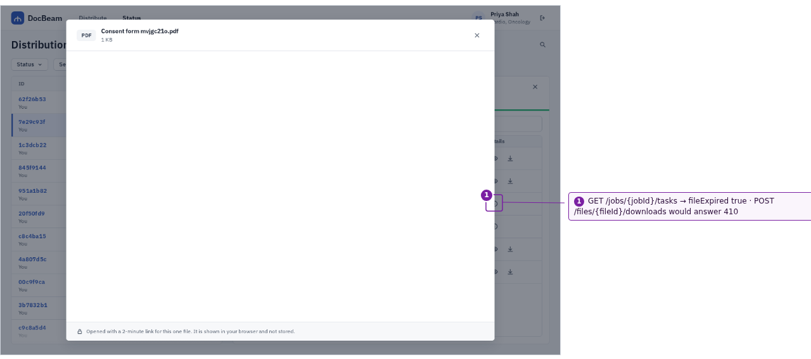

| Marker | Where it comes from |
|---|---|
| 1 | `GET /jobs/{jobId}/tasks` → `fileExpired` true (an info icon instead of the buttons); asking anyway would answer `410` |

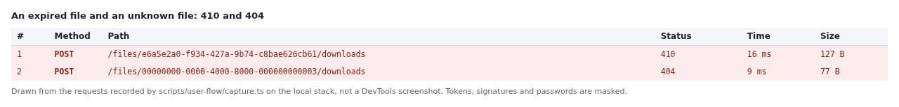

### `S3 GET (presigned download or preview link)`

*When it fires:* straight after the answer above. **Preview** reads it with `fetch(url)` and draws the bytes in a sandboxed viewer (a PDF viewer, a Word and Excel renderer, or an image). **Download** opens the link as a navigation (an anchor click), and S3's `response-content-disposition: attachment; filename=…` makes the browser save it under the original name. *Answer:* `200` and the bytes; an old or altered link is `403` (see "Presigned links").

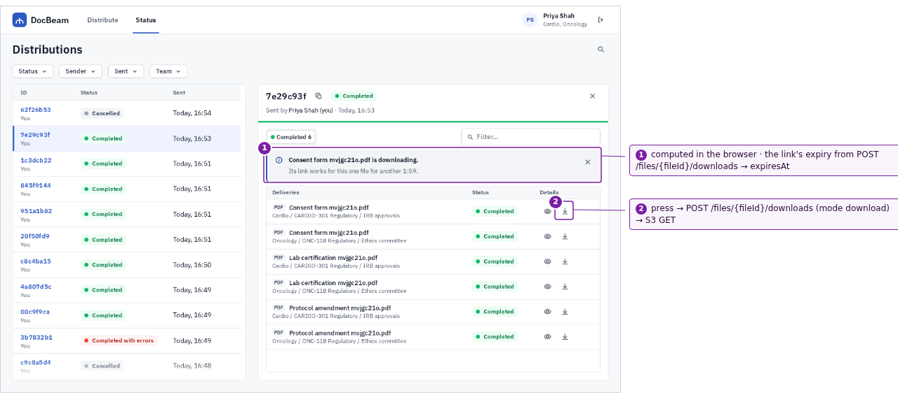

| Marker | Where it comes from |
|---|---|
| 1 | press → `POST /files/{fileId}/downloads` (mode download) → `S3 GET` |
| 2 | computed in the browser: the notice's countdown, from `POST /files/{fileId}/downloads` → `expiresAt` |

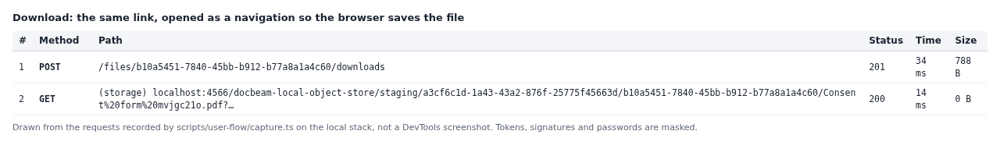

### Why it works this way

The API checks who may have the file once, then hands out a link that lets S3 do the transfer, so downloads never pass through the API (ADR-002). The link is short because it works for anyone who holds it (ADR-004). Delivered documents also live in the platform's own store; this download is of the staged upload, which is why it expires after 33 days while the delivered copy does not.

---

## Appendix A: every call the web app can make

This list was made by reading the code (`web/src`), and `scripts/check-api-map.ts` fails if a call in the code, a public gateway route, a request seen in the recording or an entry here is missing. Each line: the call, where the code makes it, and where this guide explains it.

**API calls** (all go to `/api/…` on the page's own address; `Authorization: Bearer <access token>` except the three auth calls)

- [x] `POST /auth/login` — `web/src/auth/session.ts` — chapter 1
- [x] `POST /auth/refresh` — `web/src/auth/session.ts` — chapter 1
- [x] `POST /auth/logout` — `web/src/auth/session.ts` — chapter 1
- [x] `POST /uploads` — `web/src/upload/api.ts` — chapter 2
- [x] `POST /files/{fileId}/multipart-uploads` — `web/src/upload/api.ts` — chapter 2
- [x] `POST /files/{fileId}/multipart-uploads/{uploadId}/parts` — `web/src/upload/api.ts` — chapter 2
- [x] `POST /files/{fileId}/multipart-uploads/{uploadId}/complete` — `web/src/upload/api.ts` — chapter 2
- [x] `GET /files` — `web/src/upload/api.ts` — chapter 2 (`?ids=`)
- [x] `GET /teams` — `web/src/components/Destinations.tsx`, `web/src/tracking/api.ts` — chapters 3 and 5
- [x] `GET /teams/{teamId}/binders` — `web/src/components/Destinations.tsx` — chapter 3
- [x] `GET /binders/{binderId}/contents` — `web/src/components/Destinations.tsx` — chapter 3
- [x] `GET /folders/{folderId}/contents` — `web/src/components/Destinations.tsx` — chapter 3
- [x] `GET /folders/search` — `web/src/destinations/search.ts` — chapter 3
- [x] `POST /jobs` — `web/src/upload/api.ts` — chapter 4
- [x] `GET /jobs` — `web/src/tracking/api.ts` — chapter 5
- [x] `GET /jobs/running` — `web/src/tracking/api.ts` — chapter 5
- [x] `GET /jobs/{jobId}` — `web/src/tracking/api.ts` — chapters 4, 5 and 6
- [x] `GET /jobs/{jobId}/tasks` — `web/src/tracking/api.ts` — chapters 5 and 6
- [x] `POST /jobs/{jobId}/retry` — `web/src/tracking/api.ts` — chapter 5
- [x] `POST /jobs/{jobId}/cancel` — `web/src/tracking/api.ts` — chapter 5
- [x] `GET /teams/members` — `web/src/tracking/api.ts` — chapters 5 and 6
- [x] `POST /files/{fileId}/downloads` — `web/src/tracking/api.ts` — chapter 7

**Straight to the object store (S3), with a presigned link from the API**

- [x] `S3 POST (presigned form)` — `web/src/upload/browser-transport.ts` — chapter 2
- [x] `S3 PUT (presigned part)` — `web/src/upload/browser-transport.ts` — chapter 2
- [x] `S3 DELETE (multipart abort link)` — `web/src/upload/browser-transport.ts` — chapter 2
- [x] `S3 GET (presigned download or preview link)` — `web/src/components/Preview.tsx`, `web/src/tracking/useFileLink.ts` — chapter 7

**The WebSocket**

- [x] `WS connect` — `web/src/live/socket.ts` — chapter 5
- [x] `WS send subscribe` — `web/src/live/socket.ts` — chapter 5
- [x] `WS receive subscribed` — `web/src/live/socket.ts` — chapter 5
- [x] `WS receive subscribe_error` — `web/src/live/socket.ts` — chapters 5 and 6
- [x] `WS receive task_update` — `web/src/live/socket.ts` — chapter 5
- [x] `WS receive job_update` — `web/src/live/socket.ts` — chapter 5

**Public routes the web app does not call** (they exist at the gateway; the checker lists them so the picture is complete)

- [x] `POST /auth/register` — switched off at the gateway for the web app; accounts are set up by an administrator (D-F1-17)
- [x] `GET /.well-known/jwks.json` — read by the services to check tokens, not by the page
- [x] `GET /.well-known/openid-configuration` — the same
- [x] `GET /audit` — the backend keeps the audit trail; the web app shows none (D-F1-13)

## Appendix B: the error answers in this guide

| Call | Status | `error.code` | `error.message` | What the page does |
|---|---|---|---|---|
| `POST /auth/login` | 401 | `UNAUTHORIZED` | "Email or password is incorrect." | red message under the form |
| `POST /auth/refresh` | 401 | `UNAUTHORIZED` | "Sign in again." | at load: shows "Sign in"; mid-session: the "Sign in again" box |
| any API call | 401 | `UNAUTHORIZED` | "Sign in again." | one refresh, then the box |
| `POST /jobs` | 422 | `INVALID_BATCH` | "Add at least one file." / "Every file needs at least one destination." | Send is off before this can happen |
| `POST /jobs` | 400 | `IDEMPOTENCY_KEY_REQUIRED` | "Send an Idempotency-Key header." | never (the page always sends one) |
| `GET /jobs/{jobId}` | 404 | `NOT_FOUND` | "That distribution was not found." | "Distribution not found" |
| `GET /jobs` | 503 | `PLATFORM_UNAVAILABLE` | "The platform is not answering. Try again in a moment." | "The list could not be loaded · Try again" |
| `POST /files/{fileId}/downloads` | 410 | `FILE_EXPIRED` | "This file is no longer available. The delivered copy is still in the team folder." | an info icon instead of the buttons |
| `POST /files/{fileId}/downloads` | 404 | `NOT_FOUND` | "That file is not available to you." | "not available" |
| S3 with an old or altered link | 403 | (S3's own XML: `AccessDenied`) | — | the page asks for a fresh link |

The `401` answers in the session dialog and the `503` of the failed list were **provoked** by the capture; the `422`, `400` and the missing distribution and file were **sent by the capture script**, because the page checks first and never asks. Every other answer in this guide came from the page's own requests.

## Appendix C: how this was recorded, and how to check it

* **Recording:** with the local stack running (`docker compose up -d --build --wait`, `docker compose run --rm seed`) and the page served (`npm run dev -w @docbeam/web`): `node --no-warnings scripts/user-flow/capture.ts`. It writes `docs/user-flow/capture/traffic.json` (every request and frame, with its step), `docs/user-flow/capture/markers.json` (the numbering of each picture) and the pictures in `docs/user-flow/img/` (1280 px wide).
* **Masking:** tokens (`eyJ…`), `X-Amz-Signature`, `X-Amz-Credential`, `Policy`, passwords, refresh tokens and cookies are replaced by `<masked>` before anything is written; the capture never reads cookies at all.
* **No gaps:** `node --no-warnings scripts/check-api-map.ts` compares the code, the gateway routes, the recording and this guide with `docs/user-flow/api-inventory.json` and fails on anything missing. It also runs in the unit tests (`tests/scripts/check-api-map.test.ts`).
